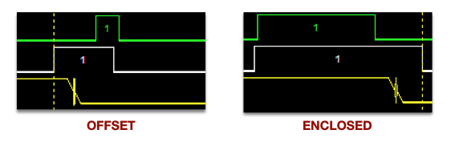
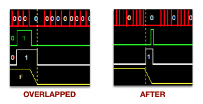

# HUB75 Driver Chip Characteristics Matrix

This document provides a comprehensive matrix of all driver chip characteristics needed for proper panel control.

**Scan** is written *1/S scan*, where S is the number of row addresses the panel's address lines select; each address lights panel rows ÷ S rows at once (the [glossary](../THEOPS.md#scan) defines it). Most panels light two rows at once. A panel that lights four rows at once, such as a 64×32 1/8-scan panel, needs its rows placed differently in the frame set; the driver does that when the `SCAN_4` chip flag is set, with the same converter (`convertRowPairs()`) as every other panel.

## Quick Reference Matrix

This table is the one place the project states each panel type's scan, address lines and test status. Other documents link here.

| Panel (chip) | Size | Color | Addr Lines | Scan | R/B Swap | G/B Swap | Init Req | Latch Style | Status |
|--------------|------|-------|------------|------|----------|----------|----------|-------------|--------|
| **FM6126A** | 64x32 | Pink | ABCD | 1/16 | - | - | **Yes** | Offset+Overlap | Tested: single panel and a pair (2026-10-09) |
| **FM6124** | 64x32 | Orange | ABCD | 1/16 | - | - | - | Enclosed | Tested: single panel (2026-10-09) |
| **FM6124C** (set as `CHIP_FM6124`) | 64x64 | - | ABCDE | 1/32 | - | - | - | Enclosed | Tested: single panel (2026-10-10) |
| **ICN2037/BP** | 128x64 | - | ABCDE | 1/32 | **Yes** | - | - | Enclosed | Tested: a 2x2 of four panels, the author's rig (2026-10-09, 2026-10-10) |
| **ICN2037/BP** (cube panels) | 64x64 | - | ABCDE | 1/32 | **Yes** | - | - | Enclosed | Panels and chip setting proven before 4.0.0; the 4.0.0 cube layer is not yet run on them (see the list below) |
| **ICN2038S** | 64x64 | - | ABCD | 1/16 | - | - | - | Enclosed | Tested: single panel (2026-10-10). Single-ended, cannot be chained |
| **MBI5124GP** | 64x32 | Green | ABC | 1/8 | - | - | **Yes** | Enclosed | Tested: single panel and two chained (2026-10-07, 2026-10-09) |
| **GS6238S** | 64x32 | Cyan | ABCD | 1/16 | - | **Yes** | - | Offset+Overlap | Tested: single panel (2026-10-09) |
| **DP5125D** | - | - | ABC | 1/8 | - | - | - | Offset+Overlap | Not run with 4.0.0: no panel on hand |

**Scan follows how a panel is built, not which column-driver chip it uses.** Scan is the number of rows lit at once. Two 64x64 panels here need opposite settings: the ICN2038S road-sign panel lights four rows at once (1/16 scan, 16 row addresses, ABCD) and needs `SCAN_4`; the FM6124C panel lights two rows at once (1/32 scan, 32 row addresses, ABCDE) and must not have it. A panel whose picture shows twice, top to bottom, needs `SCAN_4`. A panel with every other horizontal band dark must not have it. The driver derives the address lines from the panel's rows and that flag ([Wiring Guide](WiringGuide.md#the-display-block)).

### Not yet proven on hardware with 4.0.0

- The 4.0.0 cube layer on six real panels. The panels and their chip setting ran before 4.0.0; the new logic (folding the net into faces, drawing across faces, edges and corners) is proven by its self-test only.
- More than two quarter-scan (`SCAN_4`) panels in one chain.
- A second adapter cabled at the same time.
- DP5125D panels.

The column clock is held to the chip's rated maximum (for the MBI5124GP, to its chain limit), and each half of the clock pulse is at least 20 ns; the ratings are in the table below. A chip with no rating in the driver's table (GS6238S, DP5125D, or a chip set by flags alone) is held to 20 MHz with a 50 ns minimum /OE pulse, and `start()` says so in its startup messages.

The driver has no `CHIP_FM6124C` setting; configure an FM6124C panel as `CHIP_FM6124`, which sets the same flags as `CHIP_MANUAL_SPEC` alone. The chip settings the driver knows are `CHIP_FM6126A`, `CHIP_FM6124`, `CHIP_ICN2037`, `CHIP_ICN2038S`, `CHIP_MBI5124GP`, `CHIP_GS6238S` and `CHIP_DP5125D`, plus `CHIP_MANUAL_SPEC` with flags for a chip not listed.

**Notes:**
- ICN2037BP is the same chip as ICN2037 in SSOP24-P-150 package
- Supporting chipsets vary by panel (see detailed sections below)

## Datasheet Clock and /OE Ratings

This table is the one place the project states each chip's datasheet clock and /OE ratings; other documents link here.

| Chip | Rated max clock | Min clock pulse (high and low) | Min /OE pulse |
|------|-----------------|--------------------------------|---------------|
| **ICN2037/BP** | 30 MHz | 20 ns | 60 ns |
| **ICN2038S** | 30 MHz | 20 ns | 40 ns |
| **FM6126A** | 30 MHz | 20 ns | 40 ns |
| **FM6124** | 30 MHz | 20 ns | 30 ns |
| **MBI5124GP** | 25 MHz one chip; 18.9 MHz in a chain (driver uses this) | 20 ns | 45 ns at VDD 5.0 V, 50 ns at VDD 3.3 V |

**Notes:**
- A 20 ns minimum pulse high and low caps the clock at 25 MHz for every chip in the table.
- A rated clock is one chip's. Inside a panel, and from one panel to the next, each chip's SDO feeds the next chip's SDI, so a clock period must also cover the slowest CLK-to-SDO delay plus the SDI setup time. MBI5124GP: 50 ns + 3 ns = 53 ns, 18.9 MHz (datasheet pp.9-10, the 3.3 V row, as for its /OE minimum); the driver holds it there. At 22.3 MHz, two chained panels lost or gained red in the first column of each panel on some images, and it flickered. ICN2037: 35 ns + 5 ns = 40 ns, 25.0 MHz; ICN2038S: 30 ns + 5 ns = 35 ns, 28.6 MHz (V2.0 and V1.1 datasheets, switching characteristics); both are at or above the 25 MHz the 20 ns pulses already allow, so neither clock changes. The FM6124 and FM6126A datasheets in `DOCs/` do not give their text to a text extractor, so their CLK-to-SDO delays have not been read (punch list).
- ICN2037: the V1.1 datasheet and `DOCs/ICN2037/ICN2037-timing.pdf` give a 60 ns minimum /OE pulse; the V2.0 datasheet gives 40 ns. The conservative 60 ns holds. V2.0's transition table (p.8) lists a 35 MHz clock; the rating on its pp.2 and 7, and in V1.1, is 30 MHz, which holds.
- ICN2038S: the datasheet has FM6126A-style register commands. The road-sign panel gives a correct picture without them.
- MBI5124GP: the driver uses the 3.3 V figure, 50 ns, as its minimum /OE pulse. Typical and maximum /OE pulse widths are in the timing table in its section below (MBI5124GP-B_C datasheet, pp.9-10).
- The driver's values are `MIN_CLK_PULSE_NS`, `RATED_CLK_HZ_*`, `MAX_CLK_HZ_*` and `MIN_OE_NS_*` in `isp_hub75_rgb3bit.spin2`; the table above is what those constants hold.

---

## Detailed Chip Documentation

Each panel type that has run on the author's bench has a **starting block** in its section: the settings and panel list for the user section of `isp_hub75_hwPanelConfig.spin2`, ready to copy (the `DISP0_` settings and one sentence per panel; the address lines are derived, not set). How the settings and the sentences work is in the [Wiring Guide](WiringGuide.md#the-display-block). The blocks name the P16-P31 pin group, the one the author's bench uses. The FM6124C and DP5125D sections have none: the FM6124C panel is configured with the FM6124 block, and no DP5125D panel has run.

### FM6126A (Pink Labels)

**Panel Model:** P3-6432-121-16s-D1.0

| Characteristic | Value | Notes |
|----------------|-------|-------|
| Address Lines | ABCD (4) | 16 row addressing |
| Scan Rate | 1/16 | Standard scan |
| Max Clock | Rated 30 MHz; the 20 ns pulse rule caps the loop at 25 MHz | See the [ratings](#datasheet-clock-and-oe-ratings) |
| Min /OE Pulse | 40 ns | |
| R/B Swap | No | |
| G/B Swap | No | |
| Init Required | **Yes** | Special power-up sequence |
| Latch Style | Offset | |
| Latch Position | Overlap | |
| Status | See the [Quick Reference Matrix](#quick-reference-matrix) | |
| 4.0.0 refresh core | **Verified**, one panel | 85.1 Hz at 8-bit, 688.9 Hz at 5-bit; overlapped latch, init sequence run (2026-10-05) |

**On-Board Chips:**
| Chip | Function | Details |
|------|----------|---------|
| FM6126A | LED column driver | 16-channel dual-buffer constant current output, max 30MHz clock, requires init sequence, has built-in color balance |
| 74HC245C | Bus transceiver | Octal 3-state bidirectional transceiver, 2V-6V, 9ns propagation delay, enables daisy-chain pass-through |
| TC7258EN | Row driver | 8-channel line scanning blanking control, integrates 74HC138 decoder + 8 power tubes (2.5A, 130mΩ), anti-burn protection |

**Chip Detail Sources:**
- [FM6126A Datasheet](https://www.alldatasheet.com/datasheet-pdf/pdf/1145498/FUMAN/FM6126A.html)
- [74HC245 Datasheet](https://assets.nexperia.com/documents/data-sheet/74HC_HCT245.pdf)
- [TC7258EN Datasheet](https://www.alldatasheet.com/datasheet-pdf/pdf/1147175/FUMAN/TC7258EN.html)

**Driver Flags:**
```spin2
CHIP_MANUAL_SPEC | LAT_STYLE_OFFSET | LAT_POSN_OVERLAP | INIT_PANEL_REQUIRED
```

**Starting block** (one panel, as run on the author's bench):
```spin2
CON
    DISP0_ADAPTER_BASE_PIN  = hwEnum.PIN_GROUP_P16_P31
    DISP0_PANEL_DRIVER_CHIP = hwEnum.CHIP_FM6126A
    DISP0_PANEL_COLUMNS     = 64
    DISP0_PANEL_ROWS        = 32
    DISP0_COLOR_DEPTH       = hwEnum.DEPTH_8BIT

DAT
disp0Panels     LONG    hwEnum.ROW_0 | hwEnum.COL_0 | hwEnum.TOP_UP
disp0PanelsEnd
```

The panels need the initialization sequence. A row of four of these is [Example 1](WiringGuide.md#example-1-a-row-of-4) in the Wiring Guide; the number of panels one adapter can drive is in the [driver limits table](WiringGuide.md#driver-limits) (calculated, not yet exercised at that count).

---

### FM6124 (Orange Labels)

**Panel Model:** P3-6432-2121-16S-D1.0 (Hackerbox)

| Characteristic | Value | Notes |
|----------------|-------|-------|
| Address Lines | ABCD (4) | 16 row addressing |
| Scan Rate | 1/16 | Standard scan |
| Max Clock | Rated 30 MHz; the 20 ns pulse rule caps the loop at 25 MHz | See the [ratings](#datasheet-clock-and-oe-ratings) |
| Min /OE Pulse | 30 ns | |
| R/B Swap | No | |
| G/B Swap | No | |
| Init Required | No | Simpler than FM6126A |
| Latch Style | Enclosed | |
| Latch Position | After | |
| Status | See the [Quick Reference Matrix](#quick-reference-matrix) | |
| 4.0.0 refresh core | **Verified**, one panel | 85.3 Hz at 8-bit, 694.1 Hz at 5-bit; the 30 ns /OE floor shown at brightness 1 (2026-10-05) |

**On-Board Chips:**
| Chip | Function | Details |
|------|----------|---------|
| FM6124 | LED column driver | 16-channel dual-buffer constant current output, max 30MHz clock, no init sequence required, simpler than FM6126A |
| 74HC245C | Bus transceiver | Octal 3-state bidirectional transceiver, 2V-6V, 9ns propagation delay, enables daisy-chain pass-through |
| TC7258EN | Row driver | 8-channel line scanning blanking control, integrates 74HC138 decoder + 8 power tubes (2.5A, 130mΩ), anti-burn protection |

**Chip Detail Sources:**
- [FM6124 Datasheet](https://www.alldatasheet.com/datasheet-pdf/pdf/1145496/FUMAN/FM6124.html)
- [74HC245 Datasheet](https://assets.nexperia.com/documents/data-sheet/74HC_HCT245.pdf)
- [TC7258EN Datasheet](https://www.alldatasheet.com/datasheet-pdf/pdf/1147175/FUMAN/TC7258EN.html)

**Driver Flags:**
```spin2
CHIP_MANUAL_SPEC
```

**Starting block** (one panel, as run on the author's bench):
```spin2
CON
    DISP0_ADAPTER_BASE_PIN  = hwEnum.PIN_GROUP_P16_P31
    DISP0_PANEL_DRIVER_CHIP = hwEnum.CHIP_FM6124
    DISP0_PANEL_COLUMNS     = 64
    DISP0_PANEL_ROWS        = 32
    DISP0_COLOR_DEPTH       = hwEnum.DEPTH_8BIT

DAT
disp0Panels     LONG    hwEnum.ROW_0 | hwEnum.COL_0 | hwEnum.TOP_UP
disp0PanelsEnd
```

The driver's limit for this panel type is in the [driver limits table](WiringGuide.md#driver-limits).

**Notes:** Simpler chip than FM6126A - no special initialization or latch timing required. Uses same bus transceiver (74HC245C) as Pink panels.

---

### FM6124C (No color label)

**Panel Model:** P3-HS23011030-600

**Panel Specifications:**
| Spec | Value |
|------|-------|
| Pixel Pitch | 3mm (P3) |
| Resolution | 64×64 pixels |
| Scan Mode | 1/32 scan, two rows lit at once |
| Interface | HUB75 |

| Characteristic | Value | Notes |
|----------------|-------|-------|
| Address Lines | ABCDE (5) | 32 row addressing (64×64 panel) |
| Scan Rate | 1/32 | Two rows lit at once; with `SCAN_4` it shows every other horizontal band dark |
| Max Clock | Rated 30 MHz; the 20 ns pulse rule caps the loop at 25 MHz | Same as FM6124 (the driver has no FM6124C setting, so it has no rating of its own for this chip) |
| R/B Swap | No | |
| G/B Swap | No | |
| Init Required | No | Same as FM6124 |
| Latch Style | Enclosed | |
| Latch Position | After | |
| Status | See the [Quick Reference Matrix](#quick-reference-matrix) | |

**On-Board Chips:**
| Chip | Function | Details |
|------|----------|---------|
| FM6124C | LED column driver | 16-channel dual-buffer constant current output, variant of FM6124, max 30MHz clock |
| 74HC245KA | Bus transceiver | Octal 3-state bidirectional transceiver, variant of 74HC245 |
| RUC7258D | Row driver | Ruichips 8-channel blanking control, built-in 3-to-8 decoder, constant charge absorption, anti-ghosting, short circuit protection (2.8A max) |

**Chip Detail Sources:**
- [FM6124 Datasheet](https://www.alldatasheet.com/datasheet-pdf/pdf/1145496/FUMAN/FM6124.html) (FM6124C is variant)
- [RUC7258 Info at Sekorm](https://en.sekorm.com/doc/1468121.html)

**Driver Flags:**
```spin2
CHIP_MANUAL_SPEC
```

Configure the panel as `CHIP_FM6124` (the driver has no FM6124C setting). Do not set `SCAN_4`.

**Notes:**
- FM6124C is a variant of FM6124 from Fuman Electronics
- RUC7258D is manufactured by Shenzhen Ruichips Semiconductor, functionally equivalent to TC7258EN
- 74HC245KA is a variant of the standard 74HC245 bus transceiver
- This is a 64×64 panel using 5 address lines (ABCDE) for 1/32 scan

---

### ICN2037 / ICN2037BP (No color label)

**Panel Models:**
| Model | Size | Serial/Batch | Notes |
|-------|------|--------------|-------|
| P2-2020210240-200 | 64×64 | S210350H00127, etc. | Cube panels (×6), label E506652 DCHY-M |
| P2-1515-128X64-32S-S2 | 128×64 | 2210BP201-88-60 | Large panels (×4 for 2×2 grid) |

**Panel Specifications (128×64):**
| Spec | Value |
|------|-------|
| Pixel Pitch | 2mm (P2) |
| LED Type | SMD1515 |
| Resolution | 128×64 pixels |
| Scan Mode | 1/32 scan (32S) |
| Interface | HUB75 |

| Characteristic | Value | Notes |
|----------------|-------|-------|
| Address Lines | ABCDE (5) | 32 row addressing |
| Scan Rate | 1/32 | Full scan |
| Max Clock | Rated 30 MHz; the 20 ns pulse rule caps the loop at 25 MHz | See the [ratings](#datasheet-clock-and-oe-ratings) |
| Min /OE Pulse | 60 ns | |
| R/B Swap | **Yes** | Red and Blue swapped |
| G/B Swap | No | |
| Init Required | No | |
| Latch Style | Enclosed | |
| Latch Position | After | |
| Status | See the [Quick Reference Matrix](#quick-reference-matrix) | |
| 4.0.0 refresh core | **Verified**, four 128x64 panels | 71.0 Hz at 8-bit to 193.3 Hz at 3-bit (the author's rig; 2026-10-04) |

**On-Board Chips (128×64 panels):**
| Chip | Function | Details |
|------|----------|---------|
| ICN2037BP | LED column driver | 16-channel constant current sink, dual latch for 50%+ higher refresh, 3-45mA output, ±2.5% accuracy, Noise Free™ technology |
| 74HC245TS | Bus transceiver | Octal 3-state bidirectional transceiver (TSSOP package) |
| 74HC04D | Hex inverter | 6 inverters for signal conditioning/buffering |
| RUC7258D | Row driver | Ruichips 8-channel blanking control, 2.8A max, anti-ghosting |

**On-Board Chips (64×64 Cube panels):**
| Chip | Function | Details |
|------|----------|---------|
| ICN2037BP | LED column driver | 16-channel constant current sink, dual latch, Noise Free™ technology |
| MW245B | Bus transceiver | Sunmoon 3-state octal transceiver (same as Cyan panels) |
| TC7262BJ | Row driver | Fuman 8-channel with anti-ghosting (same as Cyan panels) |

**Chip Detail Sources:**
- [ICN2037 Datasheet (Olympian LED)](https://olympianled.com/wp-content/uploads/2021/05/ICN2037_datasheet_EN_2017_V2.0.pdf)
- [74HC04 Datasheet (TI)](https://www.ti.com/lit/ds/symlink/sn74hc04.pdf)
- [RUC7258 Info at Sekorm](https://en.sekorm.com/doc/1468121.html)
- [MW245 Datasheet](https://datasheet4u.com/datasheet-pdf/Sunmoon/MW245/pdf.php?id=1328898)
- [TC7262 Datasheet](https://www.alldatasheet.net/datasheet-pdf/pdf/1147196/FUMAN/TC7262.html)

**Driver Flags:**
```spin2
CHIP_MANUAL_SPEC | RB_SWAP
```

**Starting block** (one 64x64 panel, as run on the author's bench; the driver handles the red/blue swap):
```spin2
CON
    DISP0_ADAPTER_BASE_PIN  = hwEnum.PIN_GROUP_P16_P31
    DISP0_PANEL_DRIVER_CHIP = hwEnum.CHIP_ICN2037
    DISP0_PANEL_COLUMNS     = 64
    DISP0_PANEL_ROWS        = 64
    DISP0_COLOR_DEPTH       = hwEnum.DEPTH_8BIT

DAT
disp0Panels     LONG    hwEnum.ROW_0 | hwEnum.COL_0 | hwEnum.TOP_UP
disp0PanelsEnd
```

**Starting block** (one 128x64 panel, the large panel; as run on the author's bench):
```spin2
CON
    DISP0_ADAPTER_BASE_PIN  = hwEnum.PIN_GROUP_P16_P31
    DISP0_PANEL_DRIVER_CHIP = hwEnum.CHIP_ICN2037
    DISP0_PANEL_COLUMNS     = 128
    DISP0_PANEL_ROWS        = 64
    DISP0_COLOR_DEPTH       = hwEnum.DEPTH_8BIT

DAT
disp0Panels     LONG    hwEnum.ROW_0 | hwEnum.COL_0 | hwEnum.TOP_UP
disp0PanelsEnd
```

The panel lists of the six-panel cube and of the author's 2x2 rig are on the [Author's Test Panel Configurations](AuthorTestConfigurations.md) page. The number of panels one adapter can drive is in the [driver limits table](WiringGuide.md#driver-limits).

**Notes:**
- Both panel sizes use the same chip setting, `CHIP_ICN2037`. Their test status is in the [Quick Reference Matrix](#quick-reference-matrix).
- ICN2037BP is same as ICN2037 in SSOP24-P-150 package
- **128×64 panels:** Use 74HC245TS + 74HC04D + RUC7258D (Ruichips row driver)
- **64×64 Cube panels:** Use MW245B + TC7262BJ (same supporting chipset as Cyan/GS6238S panels)

---

### ICN2038S (No color label) - Road-Sign Display Panel

**Panel Model:** 64×64 (road-sign display panel)

| Characteristic | Value | Notes |
|----------------|-------|-------|
| Address Lines | ABCD (4) | 16 row addressing; the driver derives the 4 lines from the panel's 64 rows and `SCAN_4` |
| Scan Rate | 1/16 | Four rows lit at once, set by the `SCAN_4` flag; without it the picture repeats twice, top to bottom |
| Max Clock | Rated 30 MHz; the 20 ns pulse rule caps the loop at 25 MHz | See the [ratings](#datasheet-clock-and-oe-ratings) |
| Min /OE Pulse | 40 ns | |
| R/B Swap | No | **Different from ICN2037** |
| G/B Swap | No | |
| Init Required | No | The datasheet has FM6126A-style register commands; the panel gives a correct picture without them |
| Latch Style | Enclosed | |
| Latch Position | After | |
| Multi-Panel | N/A | Single-ended panel (no daisy-chain by construction). Test status: see the [Quick Reference Matrix](#quick-reference-matrix) |

**Driver Flags:**
```spin2
CHIP_MANUAL_SPEC | SCAN_4
```

**Starting block** (one panel, as run on the author's bench; the panel is single-ended, so there is one sentence):
```spin2
CON
    DISP0_ADAPTER_BASE_PIN  = hwEnum.PIN_GROUP_P16_P31
    DISP0_PANEL_DRIVER_CHIP = hwEnum.CHIP_ICN2038S
    DISP0_PANEL_COLUMNS     = 64
    DISP0_PANEL_ROWS        = 64
    DISP0_COLOR_DEPTH       = hwEnum.DEPTH_8BIT

DAT
disp0Panels     LONG    hwEnum.ROW_0 | hwEnum.COL_0 | hwEnum.TOP_UP
disp0PanelsEnd
```

The panel is single-ended; it cannot be daisy-chained. The driver's limit for this type is in the [driver limits table](WiringGuide.md#driver-limits).

**Notes:**
- Similar to ICN2037 but with **no R/B swap**, and the driver flags it `SCAN_4` (four rows lit at once); scan follows how the panel is built (see the note under the Quick Reference Matrix)
- Commercial all-weather panel, single-ended construction

---

### MBI5124GP (Green PCBs)

**Panel Model:** P4-1921-8S-V2.0

**Panel Specifications:**
| Spec | Value |
|------|-------|
| Pixel Pitch | 4mm (P4) |
| LED Type | SMD1921 |
| Resolution | 64×32 pixels |
| Panel Size | 256mm × 128mm |
| Scan Mode | 1/8 scan |
| Interface | HUB75 |

| Characteristic | Value | Notes |
|----------------|-------|-------|
| Address Lines | ABC (3) | 8 row addressing |
| Scan Rate | 1/8 | Special scan pattern |
| Max Clock | Rated 25 MHz (one chip); the 20 ns pulse rule caps the loop at 25 MHz; 18.9 MHz in a chain | The driver uses the chain limit: CLK-to-SDO 50 ns + SDI setup 3 ns (datasheet pp.9-10); see the ratings notes above |
| Min /OE Pulse | 45 ns at VDD 5.0 V, 50 ns at VDD 3.3 V | Datasheet minimum; typical and maximum are in the timing table below |
| R/B Swap | No | |
| G/B Swap | No | |
| Init Required | **Yes** | The driver writes each chip's configuration register at start (below) |
| Latch Style | Enclosed | |
| Latch Position | After | |
| Status | See the [Quick Reference Matrix](#quick-reference-matrix) | Two panels chained end to end run as one 128x32 display |
| 4.0.0 refresh core | **Verified**, one and two panels | At the 18.6 MHz chain clock: one panel 71.2 Hz at 8-bit, 582.7 Hz at 5-bit; two chained 70.9 Hz at 8-bit, 292.1 Hz at 5-bit (2026-10-07, measured). Configuration register written at start |

**On-Board Chips:**
| Chip | Function | Details |
|------|----------|---------|
| MBI5124GP | LED column driver | 16-channel constant current (1-25mA), max 25MHz, ghosting elimination via pre-charge circuit, current accuracy ±2.5% |
| TC7258EN | Row driver | 8-channel line scanning blanking control, integrates 74HC138 decoder + 8 power tubes (2.5A, 130mΩ) |
| (Unknown) | Bus transceiver | Hidden under plastic housing - still investigating |

**Chip Detail Sources:**
- [MBI5124 Datasheet (Macroblock)](https://www.mblock.com.tw/upload/Datasheet/LED%20Driver%20IC/MBI5124/MBI5124%20Preliminary%20Datasheet_V1.01_EN.pdf)
- [MBI5124GP at LCSC](https://www.lcsc.com/product-detail/LED-Drivers_MBI5124GP_C82595.html)
- [TC7258EN Datasheet](https://www.alldatasheet.com/datasheet-pdf/pdf/1147175/FUMAN/TC7258EN.html)

**Driver Flags:**
```spin2
CHIP_MANUAL_SPEC | CHIP_UNK_LAT_END_ENCL | SCAN_4 | INIT_PANEL_REQUIRED
```

**Starting block** (one panel, as run on the author's bench):
```spin2
CON
    DISP0_ADAPTER_BASE_PIN  = hwEnum.PIN_GROUP_P16_P31
    DISP0_PANEL_DRIVER_CHIP = hwEnum.CHIP_MBI5124GP
    DISP0_PANEL_COLUMNS     = 64
    DISP0_PANEL_ROWS        = 32
    DISP0_COLOR_DEPTH       = hwEnum.DEPTH_8BIT

DAT
disp0Panels     LONG    hwEnum.ROW_0 | hwEnum.COL_0 | hwEnum.TOP_UP
disp0PanelsEnd
```

Two panels chained end to end run as one 128x32 display: the same settings, and a panel list of two sentences. The adapter plugs into the right-hand panel as you face the front, so `C0` is in column 1 and `C1` in column 0:
```spin2
DAT
disp0Panels     LONG    hwEnum.ROW_0 | hwEnum.COL_1 | hwEnum.TOP_UP      ' C0, right-hand panel
                LONG    hwEnum.ROW_0 | hwEnum.COL_0 | hwEnum.TOP_UP      ' C1, left-hand panel
disp0PanelsEnd
```

The driver writes each chip's configuration register at start and holds the column clock to the chip's chain limit (18.9 MHz; see the [ratings](#datasheet-clock-and-oe-ratings)). The driver limit for this type is in the [driver limits table](WiringGuide.md#driver-limits).

**Notes:**
- `CHIP_UNK_LAT_END_ENCL` is a chip number, not a flag: it lands in the chip byte, which the refresh core does not read as flags. The latch and clock timing come from the chip name itself (the refresh core treats `CHIP_MBI5124GP` specially), so a `CHIP_MANUAL_SPEC | flags` value cannot stand in for it
- 1/8 scan creates complexity for multi-panel
- MBI5124 has built-in ghosting elimination (pre-charge circuit)
- Panel has both input and output HUB75 connectors (daisy-chain capable hardware)
- Some chips hidden under plastic LED housing - cannot visually identify
- Multi-panel daisy-chain works once the clock is held to the chain limit. At 22.3 MHz the first column of each panel lost or gained red in some rows on some images (each panel's first stage misses the bit the stage before it hands on), and it flickered
- The bus transceiver chip is still unidentified (hidden under the housing)

---

### GS6238S (Cyan Label)

**Panel Model:** P2.5-16S-V1.0 (S210164-M00739)

| Characteristic | Value | Notes |
|----------------|-------|-------|
| Address Lines | ABCD (4) | 16 row addressing |
| Scan Rate | 1/16 | Standard scan |
| Max Clock | No rating in the driver's table | No public datasheet; the driver holds 20 MHz and a 50 ns /OE minimum |
| R/B Swap | No | |
| G/B Swap | **Yes** | Green and Blue swapped |
| Init Required | No | |
| Latch Style | Offset | |
| Latch Position | Overlap | |
| Status | See the [Quick Reference Matrix](#quick-reference-matrix) | Identify, colour and scroll correct at 8-bit; clock held to 20 MHz |

**On-Board Chips:**
| Chip | Function | Details |
|------|----------|---------|
| GS6238S | LED column driver | LED driver with G/B swap characteristic |
| MW245B | Bus transceiver | Sunmoon 3-state octal bus transceiver, equivalent to 74HC245, CMOS/TTL compatible, ESD >8KV |
| TC7262BJ | Row driver | 8-channel line scanning with integrated 138 decoder + 8 power PMOS (2.5A, 120mΩ), supports 1-8 scan, anti-ghosting |

**Chip Detail Sources:**
- [MW245 Datasheet](https://datasheet4u.com/datasheet-pdf/Sunmoon/MW245/pdf.php?id=1328898)
- [TC7262 Datasheet](https://www.alldatasheet.net/datasheet-pdf/pdf/1147196/FUMAN/TC7262.html)

**Driver Flags:**
```spin2
CHIP_MANUAL_SPEC | LAT_STYLE_OFFSET | LAT_POSN_OVERLAP | GB_SWAP
```

**Starting block** (one panel, as run on the author's bench; the driver handles the green/blue swap):
```spin2
CON
    DISP0_ADAPTER_BASE_PIN  = hwEnum.PIN_GROUP_P16_P31
    DISP0_PANEL_DRIVER_CHIP = hwEnum.CHIP_GS6238S
    DISP0_PANEL_COLUMNS     = 64
    DISP0_PANEL_ROWS        = 32
    DISP0_COLOR_DEPTH       = hwEnum.DEPTH_8BIT

DAT
disp0Panels     LONG    hwEnum.ROW_0 | hwEnum.COL_0 | hwEnum.TOP_UP
disp0PanelsEnd
```

The driver's limit for this panel type is in the [driver limits table](WiringGuide.md#driver-limits).

**Notes:** Uses different supporting chipset than Pink/Orange/Green panels - MW245B transceiver (Sunmoon) instead of 74HC245C, and TC7262BJ row driver instead of TC7258EN.

---

### DP5125D (No color label)

**Panel Model:** Unknown

| Characteristic | Value | Notes |
|----------------|-------|-------|
| Address Lines | ABC (3) | 8 row addressing |
| Scan Rate | 1/8 | Special scan pattern |
| Max Clock | Unknown | No rating in the driver's table; the driver holds 20 MHz and a 50 ns /OE minimum |
| R/B Swap | No | |
| G/B Swap | No | |
| Init Required | No | |
| Latch Style | Offset | |
| Latch Position | Overlap | |
| Status | See the [Quick Reference Matrix](#quick-reference-matrix) | |

**Driver Flags:**
```spin2
CHIP_MANUAL_SPEC | LAT_STYLE_OFFSET | LAT_POSN_OVERLAP | SCAN_4
```

---

## Driver Flag Reference

| Flag | Hex Value | Description |
|------|-----------|-------------|
| `LAT_STYLE_OFFSET` | $100 | Latch signal uses offset timing style |
| `LAT_POSN_OVERLAP` | $200 | Latch position overlaps with data clock |
| `INIT_PANEL_REQUIRED` | $400 | Panel requires special initialization sequence at power-up |
| `RB_SWAP` | $1000 | Red and Blue color channels are physically swapped |
| `SCAN_4` | $2000 | Four rows lit at once (1/8 scan on a 32-row panel); the converter is the same as for every other panel and differs only in where each row lands in the frame set, and the refresh line holds two column clocks for every panel column |
| `GB_SWAP` | $4000 | Green and Blue color channels are physically swapped |

---

## Chip Initialization Sequences

Some LED driver chips require special initialization sequences at power-up before they operate correctly. This section documents the known initialization requirements.

### FM6126A Initialization Sequence

The FM6126A requires initialization of two internal configuration registers before normal operation. This initialization must be performed once at power-up.

#### Register Structure

The FM6126A has at least two documented configuration registers accessed via a special latch timing mechanism:

| Register | Latch Timing | Purpose |
|----------|--------------|---------|
| REG11 | LE HIGH during last 11 CLKs | Brightness/gain settings |
| REG12 | LE HIGH during last 12 CLKs | Output enable control |

#### Register Bit Definitions

**Register 11 (Brightness/Gain):**
```
Bits:    15 14 13 12 11 10  9  8  7  6  5  4  3  2  1  0
         [ Lower Blank #1 ][  Intensity (6-bit)  ][ Inflection ][ LGC ][OE]
Default:  1  1  1  1  1  1  1  1  1  1  0  0  1  1  1  0  = 0xFFCE
Max Bright: 0  1  1  1  1  1  1  1  1  1  1  1  1  1  1  1  = 0x7FFF
```

**Register 12 (Output Enable):**
```
Bits:    15 14 13 12 11 10  9  8  7  6  5  4  3  2  1  0
                              [OE]
Enable:   0  0  0  0  0  0  1  0  0  0  0  0  0  0  0  0  = 0x0200
```

#### Simplified Init Values (Typical Use)

For 100% brightness with output enabled:
- **REG11**: Bit 0 = LOW, bits 1-15 = HIGH → `0x7FFE` or pattern `01111111 11111110`
- **REG12**: Only bit 9 = HIGH → `0x0200` or pattern `00000010 00000000`

#### Init Sequence Pseudocode

```
function FM6126A_Init(panel_width):
    # Setup
    OE = HIGH (outputs disabled)
    LATCH = LOW
    CLK = LOW

    # === Write REG11 (Brightness) ===
    for col in 0 to (panel_width - 1):
        bit_pos = col MOD 16

        # Set data: bit0=LOW, all others HIGH
        if bit_pos == 0:
            RGB_DATA = LOW (all color pins)
        else:
            RGB_DATA = HIGH (all color pins)

        # Assert LATCH during last 11 columns
        if col >= (panel_width - 11):
            LATCH = HIGH
        else:
            LATCH = LOW

        # Clock pulse
        CLK = HIGH
        wait(~30ns)
        CLK = LOW

    LATCH = LOW  # Latch data into REG11
    wait(~1us)

    # === Write REG12 (Output Enable) ===
    for col in 0 to (panel_width - 1):
        bit_pos = col MOD 16

        # Set data: only bit9=HIGH
        if bit_pos == 9:
            RGB_DATA = HIGH
        else:
            RGB_DATA = LOW

        # Assert LATCH during last 12 columns
        if col >= (panel_width - 12):
            LATCH = HIGH
        else:
            LATCH = LOW

        # Clock pulse
        CLK = HIGH
        wait(~30ns)
        CLK = LOW

    LATCH = LOW  # Latch data into REG12
    OE = LOW     # Enable outputs
```

#### Key Timing Notes

- Data is clocked to ALL RGB pins simultaneously (R1, G1, B1, R2, G2, B2)
- This configures all FM6126A chips across the panel in parallel
- Clock rate during init can be slower than normal operation
- LATCH assertion timing is critical: must be exactly 11 or 12 clocks from end
- For multi-panel chains, `panel_width` = total columns across all panels

#### References

- [rpi-rgb-led-matrix FM6126A discussion](https://github.com/hzeller/rpi-rgb-led-matrix/issues/746)
- [ESP32-HUB75-MatrixPanel-DMA implementation](https://github.com/mrcodetastic/ESP32-HUB75-MatrixPanel-DMA)
- Driver implementation: `isp_hub75_rgb3bit.spin2:resetPanelFM6126()`

---

### MBI5124 Initialization Sequence

Source: MBI5124 datasheet V0.01 (`DOCs/MBI5124GP/MBI5124GP-B_C.pdf`), p.2 (pins), p.12 (configuration register and commands), pp.9-10 (timing). Driver: `isp_hub75_rgb3bit.spin2`, `resetPanelMBI5124()`, run once at start before the refresh cog takes the pins.

#### Commands

The chip counts CLK rising edges while LE is high, and acts when LE falls:

| CLK rising edges with LE high | Command | Action when LE falls |
|---|---|---|
| 0 | Latch data | the serial data goes to the output latch |
| 1 | Latch data | the serial data or buffer data goes to the output latch |
| **4** | **Write configuration** | the serial data goes to the configuration register |
| 5 | Read configuration | the configuration register shifts out on SDO |
| 2, 3, more than 5 | none | not to be used |

The refresh latch raises LE with CLK low, so it is always a 0-edge latch.

#### Configuration register (16 bits, one value per LED colour)

| LED colour | Bits F..0 | Hex |
|---|---|---|
| Red | `0111 1101 0110 1011` | `$7D6B` |
| Green | `1111 0001 0110 1011` | `$F16B` |
| Blue | `1110 1101 0110 1011` | `$ED6B` |

The datasheet gives these values and does not define the individual bits.

#### What the driver sends

The write command stores every chip's shift register at once, so all three colours are written together, each on its own data lines (R1 and R2 carry the red value, G1 and G2 green, B1 and B2 blue; with `RB_SWAP` the R and B lines exchange values):

1. /OE high (outputs off), LE low, CLK low.
2. One bit per CLK rising edge, MSB first, for every shift stage on one data line of the chain: panel count x panel columns, doubled for a `SCAN_4` panel (two panels of 64 columns: 256 stages, 16 chips per line). A chain is a whole number of 16-stage chips, so repeating the 16-bit value leaves each chip holding its colour's value.
3. LE high, four CLK rising edges, LE low: write configuration.

The init runs from Spin2, so every edge is far longer than the datasheet's setup and hold times (3 ns and 5 ns for SDI, 5 ns for LE). The register cannot be read back on this hardware: the read command shifts it out on SDO, which at the end of a chain goes to the last panel's output connector, not back to the P2.

#### Clock limit in a chain

SDO changes on the CLK rising edge, 28 to 50 ns after it (pp.9-10), and the next chip needs SDI 3 ns before its next rising edge. So a clock period is at least 53 ns, 18.9 MHz, below the chip's 25 MHz single-chip rating. The driver holds MBI5124GP panels to that limit (18.6 MHz at 335 MHz). The configuration register was not the cause of the first-column fault seen at 22.3 MHz: with the init written and the clock at 22.3 MHz the fault remained, and at the chain limit it was gone.

---

### Chips Without Initialization

The following chips do NOT require special initialization sequences:

| Chip | Notes |
|------|-------|
| FM6124 | Simpler variant of FM6126A, no init needed |
| FM6124C | Variant of FM6124 |
| ICN2037 / ICN2037BP | Works immediately at power-up |
| ICN2038S | Similar to ICN2037 |
| GS6238S | No init sequence |
| DP5125D | No init sequence |

These chips operate as standard shift registers - clock in data, latch, enable outputs.

---

## Scan Rate / Address Line Relationship

| Address Lines | Row addresses (S) | Scan | Typical panel height |
|---------------|-------------------|------|----------------------|
| ABC (3) | 8 | 1/8 scan | 16, 32 rows |
| ABCD (4) | 16 | 1/16 scan | 32, 64 rows |
| ABCDE (5) | 32 | 1/32 scan | 64, 128 rows |

**How scan works** (the term is defined in the [glossary](../THEOPS.md#scan)):
- A panel is **1/S scan**, where S is the number of row addresses its address lines select; each address lights panel rows ÷ S rows at once
- The refresh cycles through all S addresses, lighting that group of rows at each
- 1/8 scan: 8 row addresses, cycling through them to draw one pass over the panel; a 64×32 panel lights 4 rows at once (the `SCAN_4` flag)
- 1/16 scan: 16 row addresses; a 64×32 panel lights 2 rows at once
- 1/32 scan: 32 row addresses; a 64×64 or 128×64 panel lights 2 rows at once

---

## Latch Timing Styles

The driver has two built-in LATCH and /OE styles and two latch positions, set by two flags. This section is the one place the project names them: *style* is **offset** (`LAT_STYLE_OFFSET`) or **enclosed** (the default, no flag); *position* is **overlap** (`LAT_POSN_OVERLAP`) or **after** (the default, no flag).

### Latch style: offset or enclosed



**FIGURE 1: LATCH_STYLE: OFFSET (left), ENCLOSED (right)**

| Signal | Color |
|-----|-----|
| LATCH | Green |
| OE! | White |
| ADDR | Yellow |

In the OFFSET case: we see OE! going high, we see the row address changing and then we see LATCH going high which latches the serial data into the chip. Then we see the OE! going low, followed by the LATCH going low.  However, in the ENCLOSED case the LATCH signal goes low before the OE! goes low.

### Latch position: overlap or after



**FIGURE 2: LATCH_POSITION: OVERLAPPED (left), AFTER (right)**

| Signal | Color |
|-----|-----|
| CLK | Red |
| LATCH | Green |
| OE! | White |
| ADDR | Yellow |

In the OVERLAPPED case: we see LATCH going high before the start of the three last serial bits of the row and ending after the last serial data bit.  However, in the AFTER case we see the LATCH signal going high after the final serial bit of the row is sent.

### Which chips use which

| Style and position | Chips |
|---|---|
| Offset and overlap | FM6126A, GS6238S, DP5125D |
| Enclosed and after | FM6124 (and FM6124C), ICN2037/BP, ICN2038S, MBI5124GP |

Every chip the driver knows without `LAT_STYLE_OFFSET` gets the same enclosed, non-overlapped latch.

---

## Multi-Panel Daisy-Chain Requirements

For successful multi-panel daisy-chaining:

1. **Data Propagation**: Each panel must cleanly pass data to the next
2. **Clock Integrity**: Clock signal must maintain integrity through chain
3. **Latch Synchronization**: All panels must latch simultaneously
4. **Initialization**: If init required, each panel may need individual init

### Tested Configurations

Which panels and chains have run on hardware is stated once, in the [Quick Reference Matrix](#quick-reference-matrix). The MBI5124GP chain runs with the clock held to the chain limit.

---

## Adding New Chip Support

To add support for a new chip:

1. Identify the chip's characteristics:
   - Address lines (ABC/ABCD/ABCDE)
   - Scan (1/8, 1/16, 1/32; whether it lights four rows at once, the `SCAN_4` flag)
   - Color swapping (R/B, G/B)
   - Clock requirements
   - Initialization needs
   - Latch timing style

2. Add chip constant to `isp_hub75_hwEnums.spin2`:
   ```spin2
   #0, CHIP_UNKNOWN, CHIP_MANUAL_SPEC, ..., CHIP_NEW_CHIP
   ```

3. Add flag combination to `getDriverFlags()` in `isp_hub75_hwBufferAccess.spin2`:
   ```spin2
   elseif eChipType == hwEnum.CHIP_NEW_CHIP
       desiredFlags := hwEnum.CHIP_MANUAL_SPEC | {required flags}
   ```

4. Add the chip's clock and /OE ratings to `columnLoopClocks()` and `oeMinimumClocks()` in `isp_hub75_rgb3bit.spin2` (new `RATED_CLK_HZ_*`, `MAX_CLK_HZ_*` and `MIN_OE_NS_*` constants, and a row in the ratings table above). A chip without them runs at 20 MHz with a 50 ns /OE minimum and says so at start.

5. If chip needs special handling, modify the PASM driver in `isp_hub75_rgb3bit.spin2` (an init sequence runs from `start()` when `INIT_PANEL_REQUIRED` is set, for the chips that have one)

6. Update `isp_hub75_panel.spin2` only if the chip's panel needs a scan pattern the converter does not already handle (the `SCAN_4` flag covers the quarter-scan case).

7. Test and measure with a logic analyzer; the tools and what they check are on the [Testing and Measurement](TestingAndMeasurement.md) page.

---

*Last Updated: October 2026 (driver 4.0.0)*
