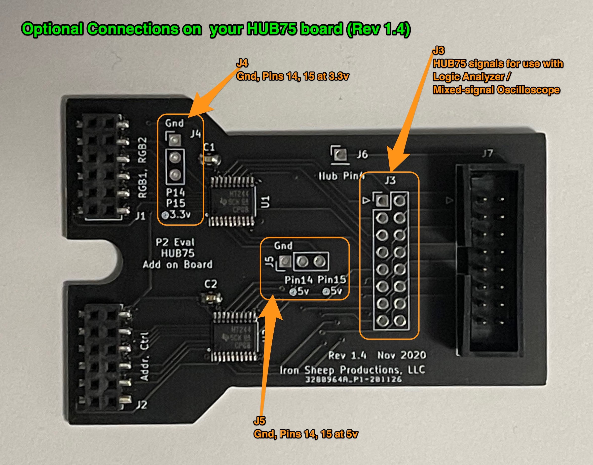
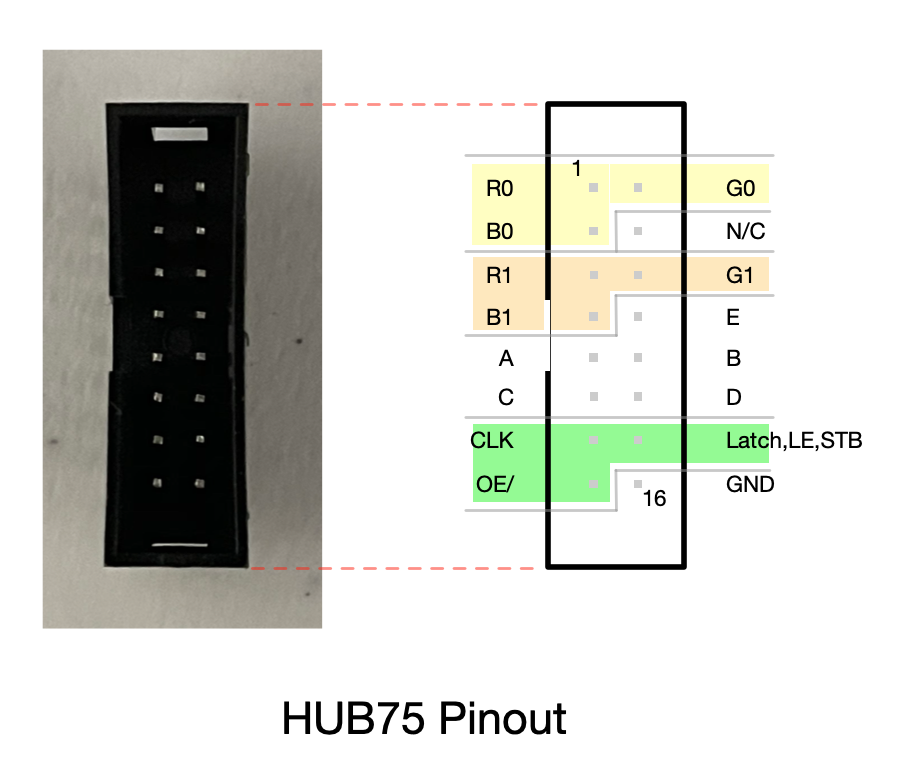

# P2 Eval HUB75 Adapter Board

![Project Maintenance][maintenance-shield]

## The board

The P2 Eval HUB75 adapter board provides a simple means by which one can connect and drive a HUB75 RGB LED Matrix panel or a small number of HUB75 Matrix panels daisy-chained together.

### Overview

This  HUB75 add-on board (#65032) is designed for use with Propeller 2 development board 2×6 accessory headers. Its dual 2×6 pass-through sockets stack on top of a pair of accessory headers on the P2 Eval Board (64000). It is also compatible with a P2 Edge Module Breadboard (#64020) or P2 Edge Mini Breakout Board (#64019) with a P2 Edge Module (#P2-EC) installed.

### Features

- Provides 3.3v to 5v level shifting for all signals at the HUB75 Connector
- Supports HUB75 panels which use A-B-C, A-B-C-D and A-B-C-D-E Address lines
- Perfect for use with the [ISP HUB75 Driver](https://github.com/parallaxinc/propeller/tree/master/libraries/community/p2/All/isp_hub75_matrix) found in the P2 Object Exchange (OBEX)


### Specifications

- Voltage : +5 VDC (supplied by P2-ES Eval Board)
- Maximum clock rate : 70 MHz (limited by the level shifter I/Cs)  [*see note*]
- Form factor: dual 2×6-pin female passthrough headers with 0.1″ spacing
- PCB dimensions: 1.9 x 2.8 in (48 x 71 mm)

NOTE: *The I/Cs on this board were selected so that we can drive our panels as fast as they support. However, our panels will likely require a much slower clock rate than this board can achieve. The maximum clock speeds for your panels will depend upon the actual chips they use.  Most of our panels are different and the manufacturers are constantly improving what they ship to us.*


## Downloads & Resources

### Downloads

- [Latest HUB75 driver build](https://github.com/ironsheep/P2-HUB75-LED-Matrix-Driver/releases) (GitHub release)
- [Hub75 Adapter Board v1.4 Schematic](images/hub75-adaptor-v1.4-schematic.pdf)

## Use of optional connectors (Rev 1.4 black)

The optional connectors allow you to monitor the signals output to the HUB75 connector by the P2 driver and possibly make use of the unused P2 Pins IO+14 and IO+15.  

J4 and J5 allow access to the 2 pins not being used to drive the HUB75 devices, while J3 allows you to fully monitor all signals at the HUB75 connector. Simply connect high-impedance probes to the header pins.

You likely received a small bag of header pins cut specifically so they can be soldered at these locations should you wish to use J3, J4 or J5.



## Use of optional connectors (Rev 1.2 red & 1.3 green)

The optional connectors are the same for the r1.2 and r1.3 boards as r1.4 but do not have the associated ground pins at J4 and J5.


## Connecting your board

The HUB75 adapter board is compatible with both the P2 Eval board and the new P2 Edge Board.  Simply choose a connector-pair then attach the board. Lastly you'll need to configure the driver so it knows which connector-pair to use: set `DISPn_ADAPTER_BASE_PIN` in `driver/isp_hub75_hwPanelConfig.spin2` to `PIN_GROUP_P0_P15`, `PIN_GROUP_P16_P31` or `PIN_GROUP_P32_P47`. See the [Wiring Guide](DOCs/WiringGuide.md#the-display-block) and [Driver Details](THEOPS.md)


## HUB75 Adapter Board Pinout

The P2 pin is shown as an offset from the first pin of the connector pair (the adapter's base pin): `io+0` is P0, P16 or P32 for the three pin groups.

| P2 Pin | Hub 75 Pin | Description |
| ------- | ------- | ------- |
| **Upper Connector** | | |
| io+15 | J4-1, J5-1 | Unused avail. at J4 at 3.3v or J5 at 5v |
| io+14 | J4-2, J5-2 | Unused avail. at J4 at 3.3v or J5 at 5v |
| io+13 | J3-7, J7-7 | Blue 2 |
| io+12 | J3-6, J7-6 | Green 2 |
| io+11 | J3-5, J7-5 | Red 2 |
| io+10 | J3-3, J7-3 | Blue 1 |
| io+9 | J3-2, J7-2 | Green 1|
| io+8 | J3-1, J7-1 | Red 1 |
| **Lower Connector** | | |
| io+7 | J3-8, J7-8 | Addr E |
| io+6 | J3-12, J7-12 | Addr D |
| io+5 | J3-11, J7-11 | Addr C |
| io+4 | J3-10, J7-10 | Addr B |
| io+3 | J3-9, J7-9 | Addr A |
| io+2 | J3-14, J7-14 | Latch Enable |
| io+1 | J3-15, J7-15 | Output Enable bar |
| io+0 | J3-13, J7-13 | Clock |
| +5v|  | VCC for the two I/Cs |

Here's a simple diagram showing related pin groups:



---

*If you have any questions about what I've written here, file an issue and I'll respond with edits to this doc to attempt to make things more clear.*

Thanks for Reading, following along. I look forward to seeing what displays you come up with. Please let me know when you do!

```
Stephen M. Moraco
Lead developer
Iron Sheep Productions, LLC.
```

> If you find this kind of written explanation useful, helpful I would be honored by your helping me out for a couple of :coffee:'s or :pizza: slices -or- you can support my efforts by contributing at my Patreon site!
>
> [](https://www.buymeacoffee.com/ironsheep) &nbsp;&nbsp; -OR- &nbsp;&nbsp; [](https://www.patreon.com/IronSheep?fan_landing=true)[Patreon.com/IronSheep](https://www.patreon.com/IronSheep?fan_landing=true)

---

Last Updated: 09 Oct 2026

[maintenance-shield]: https://img.shields.io/badge/maintainer-stephen%40ironsheep.biz-blue.svg?style=for-the-badge
