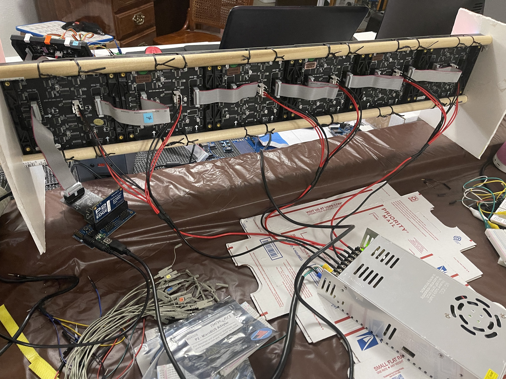
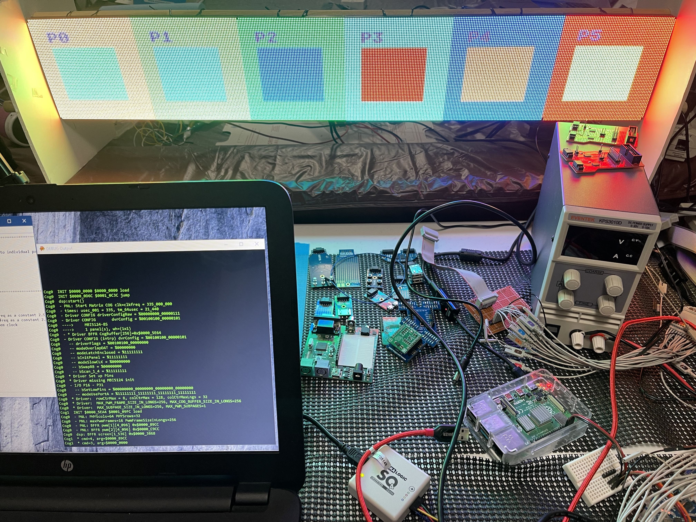
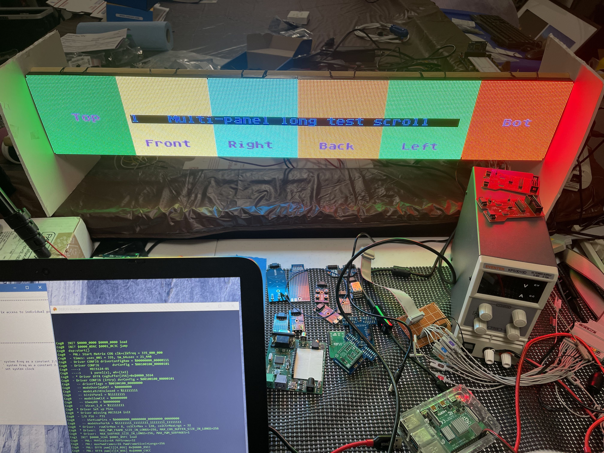
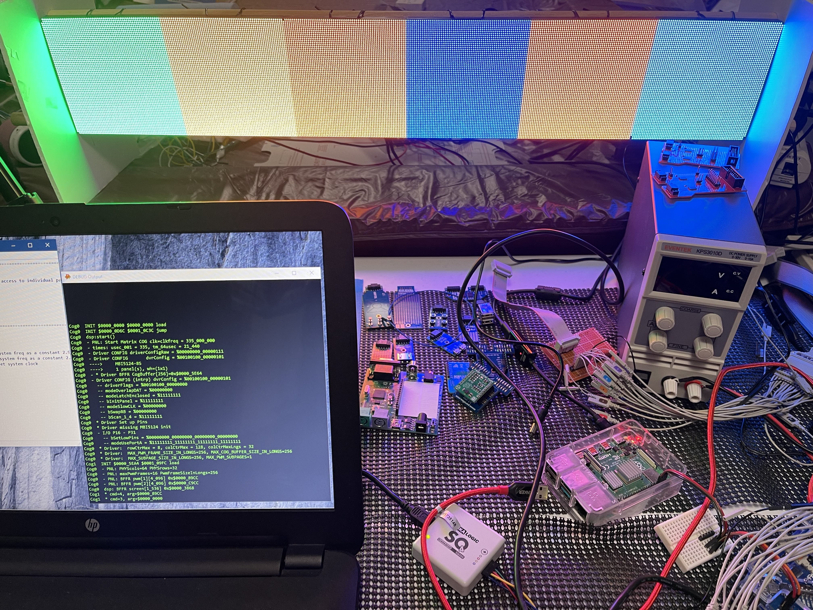

# Hardware Turn-on

## Awakening the HUB75 LED Matrix Driver for Propeller 2

![Project Maintenance][maintenance-shield]

The version I'm developing with is a P3 64x32 HUB75 matrix which I originally bought from Amazon. What HUB75 panels are, the signals they expect and why their driver ICs differ are in the README's [background section](README.md#background-hub75-rgb-led-matrix-panels).

### Pages: [README](README.md) | Hardware Turn-on | [Driver Details](THEOPS.md) | [Change Log](ChangeLog.md)

## Bringing up your own display

The five steps from a new adapter and panels to a working display, and the first program to draw on it, are on the [Quick Start](DOCs/QuickStart.md#bring-up-your-display) page.

## My Panel

The panels I'm using are marked with **P3-6432-121-16s-D1.0**  Which tell us that it is 64w x 32h (6432) and 16 addressed lines (16s).  This board uses FM6126A driver chips and TC7258EN chips for line address decoding. Lastly is uses 74HC245s to buffer the incoming signals and forward them to the output conector.  The FM6126A requires that we latch the data very differently in that instead of latching after the stream of bits for a line, we set the latch during the last 3 bits of each line. (per the Datasheet)  Additionally, the FM6126A requires initialization of two registers before it runs as a normal panel. This was quite the discovery as the Chinese Datasheet says the two registers exist but doesn't provide detail. Finding details and implementing the initialization was an effort of blending what I saw in posts which showed various forms of coce and other posts describing their reverse engineering of the same effort. But, it's all working, so I'm past this!

## Development Environment

Here we see my P2 Eval board with flying leads going to a splitter board I hand made so I can feed the panel and watch the signals with a Logic Analyzer.

## Project goals

The goals of the project, which this turn-on served, are in the README's [Project goals](README.md#background-project-goals).

**NOTE:** The refresh rates the driver reaches, at every colour depth, are measured on the author's rig and on single panels, and are listed in the [Wiring Guide](DOCs/WiringGuide.md#measured-refresh). The driver aims for the rate you set in `DISPn_TARGET_REFRESH_HZ` (default 60 Hz) and lights the panels as brightly as that rate allows.

----

> If you find this kind of written explanation useful, helpful I would be honored by your helping me out for a couple of :coffee:'s or :pizza: slices -or- you can support my efforts by contributing at my Patreon site!
>
>  &nbsp;&nbsp; -OR- &nbsp;&nbsp; [Patreon.com/IronSheep](https://www.patreon.com/IronSheep?fan_landing=true)

----

### The Eval Adapter Board

Since the project goals are speed related, flying leads are not good enough to get to the higher speeds... so the driver is built around this Eval Adapter board:

On this board you see 3.3v to 5v level shifters. I found that at higher speeds the clock, latch and OEb signals were falling below the signal threshold. This was a great exercise in Logic Analyzer use as I had originally set my input thresholds for 3.3v signals and of course they looked perfectly timed.  When I couldn't get reliable shifting and latching a had the thought that I'm dealing with 5v logic on the panels. Silly me, I had the LA configured for the output logic form, not the panel form of signal. So I switched to 5v threshold and then immediately saw that I was not at all clocking cleanly. quickly interposed the level shifer pcb that I had laying around and all the signals snapped to, as I really needed to see!  I was back in the land of the code I write now drives the signals I expect...  whew!

### 1st Order of HUB75 Adapter Boards arrived!

The boards arrived from JLCPCB! After determing that mechanically they fit Figure (1) below, then I built one up - Figure 2 and then after some power and ground double checks, I connected the new adapter PCB - Figure (3), lastly I connected up the Logic Analyzer flying leads so that I can verify all of the control/data signals to the panel - Figure (4).

It turned on completely. It also scared me at first (*you'll notice that it's on a different connector than my original flying leads test setup.*) This caused my driver to have a few hickups as I was straightening out what the new pins were! 

But, I can't complain. After the driver issues were "sorted" this 1st run of boards turned out to be 100% functional. It's a good feeling!

## P2 Cube Driver Checkout

One of the projects the P2 community is working on is a 6-sided cube of 64x64 panels.  I'm certifying the driver for use on this P2 Cube project. 

The P2 Forum Thread is found here: [P2 P2 Cube](https://forums.parallax.com/discussion/172696/p2-p2-cube/p1) 

And the repository for design and physical objects is found here [Repository: P2 P2 Cube](https://github.com/jshook/p2_p2_cube)

How the driver folds six panels into a cube is in the [Wiring Guide](DOCs/WiringGuide.md#the-cube). The pictures below are of the test jig.

This is the back of my 6 x 64x64 panel driven with a 5V 60A power supply so we can test full display Brightness. 

This is a snapshot of the 6 x 64x64 panel showing the driver configured for a single panel display - the pic is a shot of an animation taking place. The 1/6th panel to the right contains the correct display the remaing 5 panels to the left are receiving the same data... just one for offset for each further panel to the left.

Mark each panel with unique content.

Trying scrolling text around what would be the sides of the cube.

Repaint panels in a loop (you can't see here) so the panels individually change colors randomly.

## Cascaded Panels

Daisy-chained panels make larger images. Here you see these panels waiting to be cabled into one display; how to describe a chain to the driver is in the [Wiring Guide](DOCs/WiringGuide.md), and the configurations the author has run are in [Author Test Configurations](DOCs/AuthorTestConfigurations.md).

## Development diary, 2020

**30 Nov 2020:** After being distracted by designing and sourcing the Eval Adapter boards I'm finally working on the driver once again.

- rundimentary scrolling text is now working
- multiple panel types are now supported (will add more as users identify the need)

**26 Nov 2020:** v1.4 PCB order placed for production run.

**16 Nov 2020:** v1.3 (green) PCB's arrived today these are better mechanical fit and have plated vias on the EVal board connectors.  This is a final form and function run before we go to production.

**20 Oct 2020:** I've made wonderful advances in this past week.

Things now working are:

- Loading and displaying images from .bmp files
- PWMing images to achieve reasonable color (initial draft)
- Displaying text in both 5x7 and 8x8 fonts

Here you can see a demonstration of the 16-bit pwm color. Of course these panels are amazingly bright. I'm running here at ~50% brightness and it's still overwhelming the camera in a lighted room.

**27 Oct 2020:** More engineering and the (red) boards arrive!

This week I've been:

- Working to formally structure the code for release
- Studied gamma correction and now have a better performing table in place
- Studied PWM for the LEDs and now have a much more accurate PWM in place (colors are looking much better)
- Have been working on more tests, demos for animation rates of display
- More videos will be coming, meanwhile, have you seen these? [YouTube Playlist for Propeller Related Videos](https://www.youtube.com/playlist?list=PLkXxMjp58T0pk1dd8pH1OV7NCf-8Tbx1M)
- **Exciting!** The initial run of the Adapter PCBs arrived!
- I checked them out mechanically, soldered the parts to one, then checked it out electrically and lastly started using it!  It came up beautifully! (*see the turn-on description above*)

## Credits

- I was encouraged by published work by **Rayman** (found on the [Parallax Forums](https://forums.parallax.com/categories/propeller-2-multicore-microcontroller)) where he wrote initial propeller v1 spin/pasm code to demonstrate how to drive his matrix panel. I found [the article](http://www.rayslogic.com/propeller/Programming/AdafruitRGB/AdafruitRGB.htm) linked to from the AdaFruit website.

## License

Licensed under the MIT License.  
 
Follow these links for more information:

### [Copyright](copyright) | [License](LICENSE)

[maintenance-shield]: https://img.shields.io/badge/maintainer-stephen%40ironsheep.biz-blue.svg?style=for-the-badge

[license-shield]: https://img.shields.io/badge/License-MIT-yellow.svg

[releases-shield]: https://img.shields.io/github/release/ironsheep/P2-HUB75-LED-Matrix-Driver.svg?style=for-the-badge

[releases]: https://github.com/ironsheep/P2-HUB75-LED-Matrix-Driver/releases
