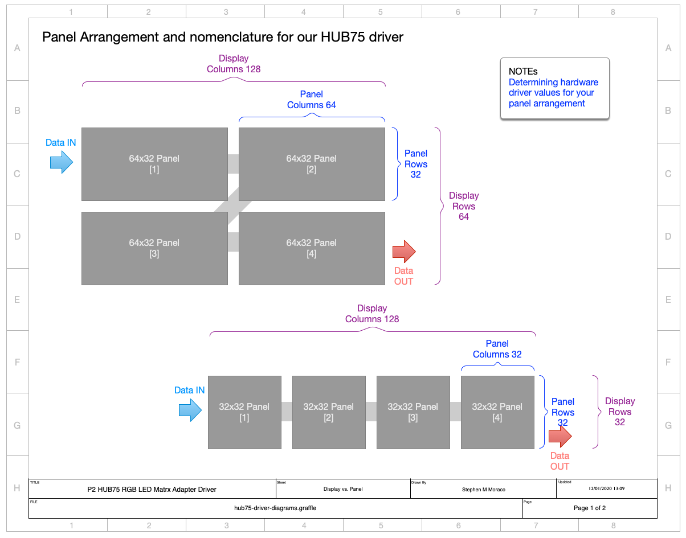
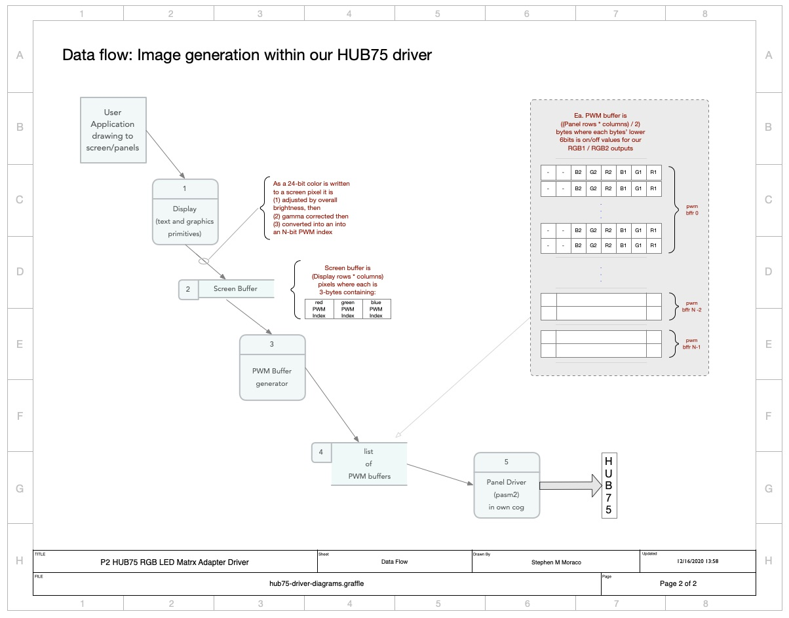
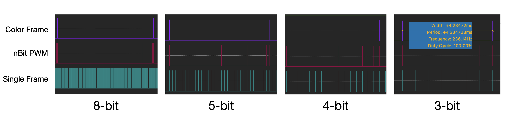

# P2 HUB75 LED Matrix Driver - Driver Details

How the driver is put together, and how a drawing call becomes light on the panel.

![Project Maintenance][maintenance-shield]

On this page you'll learn what files make up the driver (and/or come with it) and what their purpose is, how to configure the driver for your hardware, and how the driver actually works, step by step, from a drawing call to the lit panel.

(*I expect that this file will continue to grow over time as our driver becomes more capable. -Stephen*)


### Pages: [README](README.md) | [Hardware Turn-on](HardwareTurnon.md) | Driver Details | [Wiring Guide](DOCs/WiringGuide.md) | [Change Log](ChangeLog.md)

Within this page:

- [Driver Files](#driver-file-organization) - the purpose of each file found in the driver
- [Glossary](#glossary) - the terms every driver document uses, each defined once
- [Configuring the Driver](#configuring-the-driver) - how to describe your panels to the driver
- [Driver Internals](#driver-internals) - the layers, the data path, how a draw reaches the panels, the frame sets and buffers, how the panels are refreshed, and the timing
- [Max Panels Supported](#driver-max-panels-supported) - I'm planning on buying panels. How many panels does this driver support?
- [HUB75 Pins](#hub75-pins-used-by-driver) - which pin carries which signal


## Driver file organization

The driver files consist of demo-top-level files as well as the driver itself.

### Demo/Top-Level Files

Here are the reference programs you can study when learning to display to your panel(s):

| DEMO TopLevel Files            |  Purpose |
|-----------------|-------------|
| demo\_hub75_color.spin2 | Presents the color features of the panel driver, displays a .bmp file |
| demo\_hub75_text.spin2 | Presents the text and scrolling features of the panel driver |
| demo\_hub75_7seg.spin2 | Presents a technique for doing multi-step animations using the panel driver |
| demo\_hub75_multiPanel.spin2 | Presents panel-centric drawing (panel fills, labels, scrolling text across panels) on a six-panel display laid out as an unfolded cube; its panel names are labels only. For the faces of a real cube use the face-centric calls (`drawFace...`) |
| demo\_hub75_5x7font.spin2 | Presents pages (every 10 sec) showing the 5x7 full character-set font |
| demo\_hub75_scroll.spin2 | Shows off the 4 supported text-scrolling directions |
| demo\_hub75_colorPad.spin2 | **TEST** Simple single-screen demo so you can check if Red Green Blue LEDs are configured correctly. (*color patch will match color name underneath if settings for color-swap are correct*) |
| demo\_hub75_numberPanels.spin2 | **IDENTIFY** Labels every panel with its cable position, its panel position and an arrow, so you can fill in and confirm your panel list |
| demo\_hub75_boundary.spin2 | **TEST** Draws once across panel seams (a crosshair, a spanning box, a circle, text across a seam) and a panel-centric line that is clipped at its panel's edge, then holds the image |
| demo\_hub75_quadPanel.spin2, demo\_hub75_multi2x2panel.spin2 | Draw to a 2x2 display and to its individual panels |

**NOTE:** these demo's are built for 64x32 panels and 64x64 panels. You may need to modify them if your panel is a different geometry.

### Test and bring-up top-level files

These are compile entry points for checking the driver and your hardware; they are not driver files and not demos:

| Top-level file | Purpose |
|-----------------|-------------|
| test\_hub75\_cube\_fold.spin2 | Cube fold self-test: runs with no panels attached and prints PASS or FAIL for each case |
| test\_hub75\_rates.spin2 | Runs a fixed workload on one adapter with the instrument and reports refresh, lit share, clock, commit and draw time; runs the frame-set handshake and take checks, the brightness steps, the colour-table and row-run self-tests |
| test\_hub75\_converter.spin2 | Compares the screen-to-PWM converters with a reference converter byte for byte, with no panels attached, and prints PASS or FAIL |
| test\_hub75\_oe\_bcm.spin2 | Stand-alone check of the output-enable-weighted refresh method on one adapter, with test patterns and monitors |
| test\_hub75\_pin\_identify.spin2 | Pin identification: toggles the HUB75 pins at known frequencies so you can tell which pin is which |
| isp\_hub75\_anlyCheck.spin2 | Pin exerciser: toggles the HUB75 board's pins so you can verify logic analyzer connections and wiring |

### Driver files

The driver itself is composed of the following files (with a few extras thrown in for fun):

| group / Driver File           |  Purpose |
|-----------------|-------------|
| **- User Configuration -** | |
| isp\_hub75_hwPanelConfig.spin2 | USER MODIFIED configuration, in its user section: describe the panels attached to each hub75 adapter (pin group, chip, panel size, color depth and the panel list; optionally a mounting override and a refresh target). Below the user section it holds the large buffers of every display, each sized from the length of that display's panel list (zero for a display that is not described); that part is **not edited** |
| isp\_hub75_hwBufferAccess.spin2 | Core - reads your panel list at startup, checks it, derives the display's layout, builds the cell address tables the drawing paths read, and holds the small per-adapter tables and the scrolling window watch. **Not edited per setup** |
| **- Core Driver -** | |
| isp\_hub75_color.spin2 |  Core - Color constants |
| isp\_hub75_colorUtils.spin2 |  Core - Color translation routines and each adapter's color table |
| isp\_hub75_display.spin2 | Core - the display API: text, lines, boxes, circles, scrolling, brightness and the commit of the screen buffer to the panels |
| isp\_hub75_fonts.spin2 | Core - fonts for text support: a 5x7 font, two 8x8 variants, and two dithered 5x7 fonts |
| isp\_hub75_cube.spin2 | Core - the cube layer: folds a six-panel net into a cube and carries face coordinates across its 12 edges |
| isp\_hub75_hwEnums.spin2 | Core - enumerations for panel, panel connection description, and the words of the panel sentences |
| isp\_hub75_panel.spin2 | Core - the layer converting the screen buffer into PWM frame sets and posting them to the refresh cog |
| isp\_hub75_rgb3bit.spin2 | Core - the PASM Hub75 refresh cog |
| isp\_hub75_screenUtils.spin2 | Core - pixel-level drawing primitives: single pixels, row and column runs, glyph blocks, scroll moves and the plot context writer |
| isp\_hub75_scrollingText.spin2 | Core - scrolling text regions (the display object holds four of them) |
| **- Extras -** | |
| isp\_hub75\_display_bmp.spin2 | **Optional** - load .bmp file content into screen buffer |
| isp\_hub75_7seg.spin2 | **Optional** - part of 7-segment demo - a digit (packaged with the demos) |
| isp\_hub75_segment.spin2 | **Optional** - part of 7-segment demo - a segment within a digit (packaged with the demos) |
| isp\_hub75\_instrument.spin2 | **Test only** - measurement: monitor smart pins on CLK, /OE, LATCH and the refresh cog's strobes, plus stopwatches. Compiled only with `HUB75_INSTRUMENT` defined by a test top file (see [Author Test Configurations](DOCs/AuthorTestConfigurations.md)) |

The structure of these files was chosen in order to (1) make it easier and less memory usage for part of the driver to access other parts and (2) make it easier for you to chose to compile the **optional** parts or not. 

Now let's see how to configure the driver.


## Glossary

Every driver document uses these terms, with exactly these meanings. Each term is defined here, and only here; other documents link to this section.

### adapter

The HUB75 adapter card. Adapter IDs are `HUB75_ADAPTER_1` through `HUB75_ADAPTER_3`, counting from 1. **Adapter *k* drives display *k*-1**: `HUB75_ADAPTER_1` drives the display configured by the `DISP0_` settings, `HUB75_ADAPTER_2` drives `DISP1_`, and `HUB75_ADAPTER_3` drives `DISP2_`.

### display

All the panels on one adapter, drawn on as one surface. Each display is configured by its own group of settings, `DISPn_`, counting from 0 (`DISP0_`, `DISP1_`, `DISP2_`).

### display coordinates

A (row, column) position on the display, with the origin (0, 0) at the top-left. For a rotated display, the origin is the top-left of the display **as mounted**: the corner the viewer sees as top-left.

### panel position

A panel's place in the display, numbered `P0`, `P1`, ... in reading order: left to right along the top row of panels, then each row below in turn, counting only the cells that hold a panel. `P0` is the top-left panel.

### panel coordinates

A (row, column) position within one panel, as the viewer sees it, with the origin (0, 0) at the panel's top-left.

### cable position

A panel's place along the ribbon cable, counted from the adapter: `C0` is the panel the adapter plugs into, `C1` is the next panel along the cable, and so on.

### buffer slot

The driver's internal order of panels within its buffers. Slot 0 is the panel at the far end of the cable, so for a display of N panels, a panel at cable position C occupies slot N-1-C. Buffer slots are used only inside the driver's mapping layer and its comments; configuration and drawing never use them.

### native coordinates

A pixel's (row, column) as the panel's own driver chips address it, before the panel's top is applied.

### panel top

The edge of a panel that is up when the panel is hung the way the manufacturer drew it. The panel's sentence says which way it points as the panel hangs: `TOP_UP`, `TOP_DOWN`, `TOP_LEFT` or `TOP_RIGHT`, the direction of the arrow the identify screen draws near that edge. A panel whose top points down is mounted at 180°.

### mounting override

How the assembled display hangs now, compared with how it was built and identified, set by the optional `DISPn_ROTATION` (`AS_BUILT`, `TOP_TO_RIGHT`, `TOP_TO_BOTTOM` or `TOP_TO_LEFT`). It applies to flat displays only; it does not apply to a cube.

### panel list

The sentences that describe one display, in cable order, one `LONG` per panel. Each sentence says where the panel sits in the display (its row and column as the viewer sees them) and its panel top. The full grammar is in the [Wiring Guide](DOCs/WiringGuide.md#the-wiring-sentences).

### face

One panel of a cube display, named `TOP`, `BOTTOM`, `FRONT`, `BACK`, `LEFT` or `RIGHT`. The face names are derived from the two cube marks. The cube section of the Wiring Guide covers faces, folding and corners in full.

### cube orientation

How a cube display is mounted, set by marking two panels of the panel list: `CUBE_TOP` on the panel that forms the top face and `CUBE_FRONT` on the one that forms the front face. The front face must share an edge with the top face. Cube orientation takes the place of the mounting override for a cube.

### face coordinates

A (face, row, column) position on a cube display. Row and column may run past the edge of the face; a pixel that does is carried across the edge onto the neighbouring face. Each face's up direction is fixed: the four side faces' up points toward `TOP`, the top face's up points toward `BACK` (so text on the top face reads correctly when viewed from the front), and the bottom face's up points toward `FRONT`.

### cell

One position in the display's grid of panels, one panel in size as the viewer sees it. A cell either holds a panel or is empty (the hole in an L-shaped display). The driver's cell address tables have one entry per cell.

### bit plane

One bit of the color depth, for every pixel of the display. A display at 8-bit color depth has eight bit planes; plane 0 is the most significant bit.

### frame set

The bit planes of one whole image, in the form the refresh cog shifts out: one frame per bit plane, plane 0 first. Each adapter has two frame sets; one is on display while a commit converts the next image into the other.

### scan

A panel's scan is written **1/S scan**, where S is the number of row addresses its address lines select. Each address lights several rows at once: **panel rows ÷ S**. The driver derives the address lines from the panel's rows and the chip's scan; you do not set them. For example:

| Panel | Row addresses (address lines, derived) | Scan | Rows lit at once |
|---|---|---|---|
| 64×32 | 16 (4 lines, ABCD) | 1/16 scan | 2 |
| 64×64 | 32 (5 lines, ABCDE) | 1/32 scan | 2 |
| 64×32 | 8 (3 lines, ABC) | 1/8 scan | 4 |

Most panels light two rows at once, one fed by each set of color pins. A panel that lights **four** rows at once, such as a 64×32 1/8-scan panel, needs its rows placed differently in the frame set; the driver does that when the panel's chip flags include `SCAN_4`, using the same converter as every other panel (`convertRowPairs()`) (called *quarter-scan* elsewhere, after the code's `SCAN_4` and `bScan_1_4`; "four rows at once" is what it means, not 1/4 of the panel).


## Configuring the driver

How the panels are arranged, cabled and hung is described by the panel list; the [Wiring Guide](DOCs/WiringGuide.md) covers it, the identify screen, the mounting override, the cube and the driver limits, with seven worked examples.

To this driver the panels look like the following:

**NOTE:** the driver supports single panels, horizontal/vertical multi-panel chains, 2-D panel grids of any shape you can cable (a 2x2, 3x2, an L, ...), and a six-panel cube, each panel with its own top. Which panel types have run on hardware, and what is not yet proven, is in the [Chip Characteristics Matrix](DOCs/ChipCharacteristicsMatrix.md#quick-reference-matrix).



**Figure 1**: Terms describing a display composed of matrix panels cabled together.

In the above image you see panels describe in terms of rows and columns, and you also see the overall display described in rows and columns but comprised of multiple panels in some arrangement.  The configuration settings following are intended to describe the geometry of your display to the driver.  The organization you describe in these settings causes the underlying driver to allocate buffer space tailored to your display and conditions the hub75 signalling to work correctly for your display. Additionally, if your panels use certain chips the signalling will be changed to conform to what those chips need to work.

Once you have the driver source files added to your project you will first need to configure the driver by modifying the following values in the file **isp\_hub75_hwPanelConfig.spin2** for each HUB75 adapter that you will be activating in your project:

The settings, their defaults and what each means are in the table of [Driver Constants used for configuration](README.md#driver-constants-used-for-configuration) in the README. That table is the one place the settings are listed. The [panel list](#panel-list) goes with them, one sentence per panel; `DISPx_ROTATION` is the optional [mounting override](#mounting-override), the two cube marks in the list set the [cube orientation](#cube-orientation), and `DISPx_TARGET_REFRESH_HZ` is the refresh rate to aim for.

Not set by you, worked out from the panel list: the number of panels (the length of the list, counted at compile time; it sizes the buffers), the address lines (from the panel rows and the chip's scan), and, at startup, the display's size in pixels, its grid of panels, and each panel's place, buffer slot and rotation. The driver prints the layout as a picture of the grid; the [Wiring Guide](DOCs/WiringGuide.md#what-a-good-config-prints) explains it.

**NOTE**: the DISPx_ is a place holder for DISP0\_\*, DISP1\_\* and DISP2\_\* constants indicating the 1st, 2nd, and 3rd HUB75 cards.

Each adapter you use is started by one call, `display.start(display.HUB75_ADAPTER_n)`, which checks the panel list, derives the layout, builds the cell address tables and the adapter's color table, hands the adapter its buffers and starts its refresh cog. (`display.startWithId()` is the same call with a debug instance number, for programs that start more than one adapter.) Adding an adapter edits only the user section of `isp_hub75_hwPanelConfig.spin2`: one `#DEFINE` and that display's block ([Wiring Guide](DOCs/WiringGuide.md#more-displays-and-optional-settings)).

## Driver internals

Here's a quick diagram you can use to gain a general understanding of how this driver operates:



**Figure 2**: Flow of data within the driver. (The figure shows the stored color values; brightness is applied by the refresh core as /OE time, not when a pixel is written.)

Basically, this image shows that the user code draws in 24-bit color values. The drawing calls look up where each pixel goes in the screen buffer (one lookup in a table built at startup from your panel list) and write it there, three bytes per pixel, after one read of the adapter's color table per channel (gamma if enabled, then the color depth). When the screen is committed (the image is transferred to the display) the screen buffer is split out into individual PWM buffers, one bit-plane frame for each bit of the color depth (together, a frame set). The commit converts into whichever of the adapter's two frame sets is not on display and posts it; the refresh core takes the posted set at the start of its next frame, so the panels never show a half-converted image. Brightness is not one of the steps in the figure: it is /OE time, applied by the refresh core, and it does not change the values stored.

A drawing call reaches the panels in these steps; the sections below describe each:

1. **At startup** (`display.start()`), the cell address tables are built from your panel list ([Pixel write](#pixel-write)).
2. **A pixel write**, or a run or block of pixels, takes its address from those tables ([Pixel write](#pixel-write)).
3. **Scrolling text moves the last frame** instead of drawing the whole window again ([Pixel write](#pixel-write)).
4. **The commit** (`display.commitScreenToPanelSet()`) converts the screen buffer into the idle frame set and posts it ([Screen commit](#screen-commit)).
5. **The refresh core** (`isp_hub75_rgb3bit.spin2`) runs continuously, takes the posted set at each frame start and shifts it into the panels ([Refresh method](#refresh-method)).

### Layers

The driver is layered so that each layer has one job:

```
┌─────────────────────────────────────────────────────────────────┐
│                    APPLICATION LAYER                             │
│  User code calls display API methods                             │
│  (demo_hub75_*.spin2 examples)                                   │
└──────────────────────────┬──────────────────────────────────────┘
                           │
┌──────────────────────────▼──────────────────────────────────────┐
│                    DISPLAY CONTROL LAYER                         │
│  isp_hub75_display.spin2 - Text, graphics, scrolling, commit     │
│  isp_hub75_screenUtils.spin2 - Pixel, run and block writes       │
│  isp_hub75_scrollingText.spin2 - Text scrolling regions          │
│  isp_hub75_colorUtils.spin2 - Color table, gamma, color math     │
│  isp_hub75_fonts.spin2 - 5x7, 8x8 and dithered 5x7 font data     │
└──────────────────────────┬──────────────────────────────────────┘
                           │
┌──────────────────────────▼──────────────────────────────────────┐
│                    BUFFER MANAGEMENT LAYER                       │
│  isp_hub75_hwBufferAccess.spin2 - Panel-list check, layout, cell │
│     address tables, window watch                                 │
│  isp_hub75_hwPanelConfig.spin2 - User configuration, buffer RAM  │
│  isp_hub75_cube.spin2 - Cube faces and edge folding              │
│  isp_hub75_hwEnums.spin2 - Constants and enumerations            │
└──────────────────────────┬──────────────────────────────────────┘
                           │
┌──────────────────────────▼──────────────────────────────────────┐
│                    PANEL MANAGEMENT LAYER                        │
│  isp_hub75_panel.spin2 - Screen buffer to PWM conversion         │
│  Converts 24-bit RGB to PWM frame sets                           │
│  Converts into the frame set not on display, then posts it       │
└──────────────────────────┬──────────────────────────────────────┘
                           │
┌──────────────────────────▼──────────────────────────────────────┐
│                    PASM2 DRIVER LAYER (Runs in dedicated COG)    │
│  isp_hub75_rgb3bit.spin2 - Real-time refresh (the refresh cog)   │
│  Clocks pixel data to panel shift registers                      │
│  Manages row addressing, latching and /OE-weighted bit planes    │
└──────────────────────────┬──────────────────────────────────────┘
                           │
┌──────────────────────────▼──────────────────────────────────────┐
│                    HARDWARE LAYER                                │
│  P2 GPIO pins (16 pins per HUB75 adapter)                        │
│  HUB75 panel interface signals                                   │
└─────────────────────────────────────────────────────────────────┘
```

The refresh runs in its own cog, so its timing does not depend on what your program is doing. The panel count, color depth and buffer sizes are fixed at compile time from the `DISPn_` settings and the length of each panel list, and up to three independent adapters can run on one P2, each with its own display object and refresh cog.

### Object dependencies

Each object lists the objects it uses in its `OBJ` section. The ones `isp_hub75_display.spin2` uses, and what the main ones use in turn:

```
demo_hub75_*.spin2 (top-level)
    └── isp_hub75_display.spin2
            ├── isp_hub75_hwBufferAccess.spin2
            │       ├── isp_hub75_hwPanelConfig.spin2
            │       │       └── isp_hub75_hwEnums.spin2
            │       ├── isp_hub75_cube.spin2
            │       └── isp_hub75_hwEnums.spin2
            ├── isp_hub75_screenUtils.spin2
            │       ├── isp_hub75_color.spin2
            │       ├── isp_hub75_colorUtils.spin2
            │       ├── isp_hub75_fonts.spin2 (dithered pixel codec)
            │       ├── isp_hub75_hwBufferAccess.spin2
            │       └── isp_hub75_hwEnums.spin2
            ├── isp_hub75_panel.spin2
            │       ├── isp_hub75_hwBufferAccess.spin2
            │       ├── isp_hub75_hwEnums.spin2
            │       └── isp_hub75_rgb3bit.spin2 (PASM2 refresh cog)
            ├── isp_hub75_scrollingText.spin2[4] (four scrolling regions)
            ├── isp_hub75_fonts.spin2
            ├── isp_hub75_color.spin2
            ├── isp_hub75_colorUtils.spin2
            ├── isp_hub75_cube.spin2
            └── isp_hub75_hwEnums.spin2

isp_hub75_display_bmp.spin2 (optional) is used by the program that loads a .bmp
```

The same object used in two places is one object. Not drawn above: `isp_hub75_rgb3bit.spin2` also uses `hwBufferAccess`, `color` and `hwEnums`; `isp_hub75_colorUtils.spin2` uses `hwBufferAccess`; `isp_hub75_cube.spin2` uses `hwEnums`; and each scrolling region uses `hwBufferAccess`, `hwEnums`, `screenUtils`, `color`, `fonts`, `colorUtils` and `cube`.

### Data path

```
┌─────────────────────────────────────────────────────────────────┐
│ APPLICATION: a display call (text, line, box, circle, scroll),  │
│              or screenUtils.drawPixelAtRC(chain, row, col, rgb) │
│              Uses 24-bit color values (0x000000 - 0xFFFFFF)     │
│              (row, col) are display coordinates, as mounted     │
└──────────────────────────┬──────────────────────────────────────┘
                           │ Look up the pixel's (or run's) address
                           │ in the cell address tables
                           │ Apply color correction: one color
                           │ table read per channel (gamma, depth)
                           ▼
┌─────────────────────────────────────────────────────────────────┐
│ SCREEN BUFFER (HUB RAM)                                         │
│  Format: 24-bit/pixel (3 bytes: R, G, B)                        │
│  Size: panels in use × panel pixels × 3 bytes                   │
│  Example: 256×128 = 98,304 bytes                                │
└──────────────────────────┬──────────────────────────────────────┘
                           │ display.commitScreenToPanelSet()
                           │ Bit extraction + PWM mapping
                           ▼
┌─────────────────────────────────────────────────────────────────┐
│ PWM FRAME SETS (HUB RAM, two per adapter)                       │
│  Format: one byte per column clock (top and bottom pixel)       │
│  Frames: color_depth frames per set, one per bit plane          │
│  Size: (panels × panel pixels / 2) × color_depth bytes          │
│  Example: 256×128 @ 8-bit = 131,072 bytes per set               │
└──────────────────────────┬──────────────────────────────────────┘
                           │ cmdWritePwmBuffer() - async command
                           │ taken by the refresh cog at a frame start
                           ▼
┌─────────────────────────────────────────────────────────────────┐
│ PASM2 DRIVER (Running continuously in dedicated COG)            │
│  Shifts each plane's rows into the panel, latches them and      │
│  lights them for a time set by the plane's weight               │
│  (see Refresh method)                                           │
└──────────────────────────┬──────────────────────────────────────┘
                           │ HUB75 signals
                           ▼
┌─────────────────────────────────────────────────────────────────┐
│ HUB75 PANEL                                                     │
│  - Shift registers receive 6 color bits (R1,G1,B1,R2,G2,B2)    │
│  - Row decoder selects active row (A,B,C,D,E address lines)    │
│  - Latch transfers shift register to LED drivers               │
│  - OE (output enable) sets how long each plane is lit           │
└─────────────────────────────────────────────────────────────────┘
```

### Pixel write

Every drawing path (text, scrolling, lines, boxes, circles, image placement, panel-centric calls and face-centric calls) finds where a pixel goes through one rule, so every path gets the same mapping. `row` and `col` are **display coordinates as the display is mounted**, with (0, 0) at the top-left (see the [glossary](#glossary)). The panels' buffer is stored panel by panel (in buffer-slot order), not as one raster, so the rule maps each pixel to its place in it.

The rule is not worked out per draw. At startup `isp_hub75_hwBufferAccess.spin2` decodes and checks your panel list, derives the grid and its lookup tables, and evaluates the rule once into the **cell address tables** (below); every drawing call reads its addresses from them:

- A single pixel is written by `drawPixelAtRCwithRGB(chainIdx, row, col, red, green, blue)` (or `drawPixelAtRC` with a 24-bit color) in `screenUtils`; its address is `pixelAddressAtRC(chainIdx, row, col)`, which is one lookup.
- A straight run of pixels (a line, a box row or column, a glyph row, a BMP row, a fill) is written by the run primitives `fillRowRun`, `fillColumnRun` and `copyRowRun`: they split the run where it crosses from one panel to the next and, for each panel, take the start address and the step between pixels from one `mountedPixelRun` lookup, then write the pixels in PASM. A run lands exactly where its pixels would one by one.
- A filled box in one color is written as one block per panel it covers (`fillMountedArea`, `mountedBlockRun`), rows in PASM.
- A scrolling-text glyph (or the gap after it) that lies wholly inside one panel is written as one block: one lookup for its top-left pixel and its two steps (`mountedBlockRun`), then every row in one PASM call (`copyGlyphBlock`, `copyGlyphRows`).
- A sloped line or a circle in one color is plotted pixel by pixel through one **plot context**: `plotContext` hands PASM the table addresses and sizes once per shape, and `plotPacked` writes each pixel from them in PASM.
- A fill of a rectangle in layout coordinates (`fillLayoutArea`, used by the panel fills) is written row by row as runs that take their addresses from `displayPixelAddress` directly, since layout coordinates are not placed as mounted.

The rule itself, for a pixel of the display as mounted (steps 1 to 3 are evaluated at startup, into the tables; steps 4 and 5 happen on every write):

1. **Hold to the mounted size.** The size the accessors report is the size as mounted: width and height swap when the mounting override `DISPn_ROTATION` is `TOP_TO_RIGHT` or `TOP_TO_LEFT` (90 or 270 degrees).

2. **Undo the display rotation** (`mountedRuleAddress`). The mounting override `DISPn_ROTATION` is physical (how the display hangs now, against how it was built); this step turns mounted coordinates into layout coordinates, the display as its panels are laid out. `AS_BUILT`, the default, leaves them unchanged.

3. **Map to the buffer** (`displayPixelAddress`). Each step is a table lookup, built once at startup from the panel list, so this step does no searching:
   - layout coordinates → the cell of the display's grid;
   - cell → panel position (a cell that holds no panel, such as the hole in an L shape, has none, and the pixel is not drawn);
   - panel position → panel coordinates (row and column within that panel, as the viewer sees it);
   - panel rotation (the panel's `TOP_` word) → native coordinates (as the panel's own chips address it);
   - panel position → buffer slot (slot = N-1-C for the panel at cable position C of N);
   - `offset = ((((slot × panelRows) + nativeRow) × panelColumns) + nativeColumn) × bytesPerColor`.

4. **Color Correction** (`colorUtils.packedCorrectedColor`, `packedCorrectedRgb`, `correctedSingleColor`): one read of the adapter's 256-entry color table per channel; the table is built at adapter start (`buildColorTable`). The table holds, for each 8-bit input, the stored value: the gamma curve if gamma is enabled (it is off unless `bGammaEnable` in `isp_hub75_colorUtils.spin2` is set), then the mapping to the color depth's bit width. A color is corrected once per call, and a run or shape is corrected once and packed (red in bits 0-7, green 8-15, blue 16-23) before its pixels are written. Brightness is not applied to the values: it is /OE time, set in the refresh core (see [Refresh method](#refresh-method)).

5. **Buffer Write**:
   ```
   screenBuffer[offset + 0] = correctedRed
   screenBuffer[offset + 1] = correctedGreen
   screenBuffer[offset + 2] = correctedBlue
   ```

**Evaluated once per panel, not per pixel.** Steps 1 to 3 are the rule; the drawing path does not evaluate them for every pixel. Within one panel the rule is a fixed rotation of the panel's native rows and columns, so at startup `hwBufferAccess` (`buildCellAddressTables`, after the mounted grid is built) evaluates the rule at three pixels of each cell of the mounted grid (the cell's first pixel, its right neighbour and the pixel below) and keeps the **cell address tables**: the offset of the cell's first pixel from the start of the screen buffer, the step to the pixel at its right and the step to the pixel below it. A pixel's address is then `buffer + offset + (row in cell × down step) + (column in cell × right step)`: one lookup (`mountedPixelAddress`, or `mountedPixelRun` with the steps, or `mountedBlockRun` for a block inside one cell). A cell with no panel has no offset (`NO_CELL_OFFSET`), and its pixels are not drawn. The run writes, and the rows of a glyph block, are written in PASM. The instrument build's self-test (`test_hub75_rates.spin2`) compares the tables with a frozen copy of the rule at every cell edge, and compares every run and block drawing with a pixel-by-pixel reference.

**Scrolling moves the last frame.** A display-centric scrolling region in one colour registers its window with the **window watch** in `hwBufferAccess` (`watchWindow`). Every drawing call reports the rectangle it writes (`noteDrawn`; a clear, a fill or a layout-coordinate write reports the whole display, `noteAllDrawn`), and the watch marks dirty each window that rectangle meets, except the window of the region drawing at that moment (`setDrawingOwner`). The watch holds up to 16 windows across all adapters. On a step whose scroll state is exactly one pixel on from the frame drawn last, a clean window is moved one pixel (`shiftRowLeft`, `shiftRowRight`, `shiftRowsUp`, `shiftRowsDown`, in PASM) and only the new edge column or row is drawn from the text. A dirty window, the first step, a step that wraps the text or the glyph rows, and a font change draw the whole window instead, so a step always shows what drawing the whole window would show. Setting a region's loop mode (`configureScrollLoopMode`, `configureScrollLoopCount`) draws its window again for that mode, since the mode decides what a sideways window shows past the text (the text again, or spaces in `SCROLL_ONCE_TO_CLEAR`) and the first window is drawn before the mode is set. A program that writes the screen buffer directly, past the driver's calls, calls `hub75Bffrs.noteAllDrawn(chain)` afterwards so every watched window is drawn in full on its next step. The instrument build's self-test compares every scroll case, a scroll with a box drawn over it and the buffer cleared between steps, and a left scroll whose `SCROLL_ONCE_TO_CLEAR` mode is set after it starts, with a reference that draws every step's whole window pixel by pixel. A second self-test (scroll oracle) compares sideways scrolls in `SCROLL_FOREVER` and `SCROLL_ONCE_TO_CLEAR`, on a line holding the text more than twice, with the same characters drawn as static text: an independent drawing, so an error shared by both scroller paths is still seen.

Panel-centric calls take (panel position, panel coordinates) in the viewer's frame, clip at the panel's edge, add the panel's display offset and then enter this same path. Face-centric calls on a cube fold a pixel across the cube's edges first, then enter it too.

### Screen commit

`display.commitScreenToPanelSet()` triggers conversion from screen buffer to PWM frames. It calls `convertScreen2PWM_14()` for a chip flagged `SCAN_4` and `convertScreen2PWM()` for every other chip (both in `isp_hub75_panel.spin2`):

1. **Wait for the previous post to be taken.** The refresh cog names the frame set it is showing in `driverShowing` at each frame start. Before converting again, the commit waits until `driverShowing` is the set it posted last (within one refresh), so the set it is about to write is never the set on display. The first commit after start has nothing to wait for.
2. **Select the PWM frame set that is not on display** (the one `driverShowing` does not name).
3. **For each group of four columns**: block-read the four top-half and four bottom-half pixels, spread each pixel pair's channel bits across the bit planes with `MERGEB`, collect the four columns' plane bytes in one long per plane, and write each plane's long once. The chip's red/blue or green/blue channel swap (`RB_SWAP`, `GB_SWAP`) is applied to each pixel's bytes on the way in (`channelOrder()`). Half-scan and quarter-scan panels share this converter (`convertRowPairs()`, called by `convertHalfScan()` and `convertQuarterScan()`); only where each row lands in the frame set differs. Panel widths are a multiple of 4 columns (checked at startup). The commit time measured on the author's rig is in the [Wiring Guide](DOCs/WiringGuide.md#commit-and-draw-time).
4. **Post the converted set** to the PASM2 driver with `cmdWritePwmBuffer()`.
5. **Return immediately** - the driver takes the set at its next frame start and continues displaying asynchronously, so the panels never show a half-converted image.

`display.showFrameSet(pFrameSet)` posts a frame set the caller built, by the same rule. It accepts only one of the adapter's two sets (build into the one that is not on display) and refuses NULL and any other address with a message naming the call. The layout is in its doc comment: plane-major, most significant bit first, row-major, one byte per column clock.

### PWM frame sets

A frame set holds one frame (bit plane) for each bit in the color depth, plane 0 being the most significant bit. The following diagram shows the constituent frames being displayed with the MSBit being displayed for the longest period and the LSBit for the shortest. Each plane's lit time is its power-of-2 weight, a number of /OE units ([Refresh method](#refresh-method)): in 3-bit the MSBit is lit 2^2 or 4 units, the next bit 2^1 or 2 units and the LSBit 1 unit; in 8-bit the MSBit is lit 128 units (2^7), the next 64, and so on down to 1 unit for the LSBit.



**Figure 3**: Creating a full color frame.

Each plane of a frame set stores one byte per column clock, in the order the panel is shifted. The byte carries two pixels, the one in the top half of the panel and the one in the bottom half:

```
Byte layout: %00 B2 G2 R2 B1 G1 R1

  Bits 0-2: red, green, blue of the first pixel (R1 G1 B1 pins)
  Bits 3-5: red, green, blue of the second pixel (R2 G2 B2 pins)
  Bits 6-7: unused
```

The planes follow one another, plane 0 (the most significant bit) first, and within a plane the bytes are row-major.

A compile-time color depth setting (`DISPx_COLOR_DEPTH`, 3 to 8 bits) specifies how rich the colors are to be for your display; the default is 8-bit (full 24-bit color):

| Depth | Colors | Levels (2^N - 1) | Bytes per pixel (buffers) |
|-------|--------|------------------|---------------------------|
| 3-bit | 512 | 7 | 6 |
| 4-bit | 4,096 | 15 | 7 |
| 5-bit | 32,768 | 31 | 8 |
| 6-bit | 262,144 | 63 | 9 |
| 7-bit | 2,097,152 | 127 | 10 |
| 8-bit | 16,777,216 | 255 | 11 |

The screen buffer always uses 3 bytes per pixel, at every depth. The rest of each pixel's buffer space is the two PWM frame sets (N/2 bytes per pixel each), which is why a pixel costs 3 + N bytes in all. The refresh rate at each depth, measured on the author's rig, is in the [Wiring Guide](DOCs/WiringGuide.md#refresh-rate).

### Buffers

Each display's buffers are sized at compile time from the length of its panel list, not from the display's bounding box: a display with a hole in it (an L shape) holds no memory for the hole, and a display that is not described has an empty panel list and zero-length buffers. A pixel takes 3 screen-buffer bytes plus one byte per bit of color depth for the two PWM frame sets (11 bytes at 8-bit). The [Wiring Guide](DOCs/WiringGuide.md#driver-limits) gives the hub RAM each display needs and the most panels one adapter can drive.

#### Screen buffer
- **Purpose**: Holds the user-drawn image in 24-bit RGB format
- **Format**: 3 bytes per pixel (R, G, B)
- **Location**: HUB RAM
- **Access**: Read/write by user code, read by the panel manager

#### PWM frame sets (two per adapter)
- **Purpose**: Pre-computed PWM data for the driver's output. One set is on display while a commit converts into the other, then they trade roles
- **Format**: one byte per column clock (two pixels), one frame per color depth bit
- **Location**: HUB RAM
- **Access**: Written by the panel manager (never the set on display), read by the PASM2 driver

#### COG buffer
- **Purpose**: Working buffer for the PASM2 driver
- **Format**: 512 bytes (128 longs), `LINE_BUFFER_BYTES`; one row of one bit plane for the whole chain
- **Location**: COG RAM (the driver's dedicated COG)
- **Access**: Internal to the driver

### Buffer table structure

The `isp_hub75_hwBufferAccess.spin2` file maintains one descriptor for each of the three HUB75 adapters. The descriptor's buffer addresses (which come from `isp_hub75_hwPanelConfig.spin2`), chip type, pin base and derived address line count are filled in when the adapter is started (`configureAdapter`, which the display's start call makes):

```
Descriptor Structure (14 LONGs per adapter):
  [0]  Screen buffer address
  [1]  PWM frameset 1 address
  [2]  PWM frameset 2 address
  [3]  Color depth (3-8)
  [4]  Bytes per color (3)
  [5]  Screen size in longs
  [6]  PWM frame size in bytes
  [7]  Display rotation (the mounting override DISPn_ROTATION, as a rotation)
  [8]  Panel columns (single panel width, native)
  [9]  Panel rows (single panel height, native)
  [10] Panel chip type
  [11] HUB75 pin base
  [12] Address line count (derived: 3, 4 or 5 lines)
  [13] Refresh target in Hz (DISPn_TARGET_REFRESH_HZ)
```

The display's size and grid are **not** in the descriptor. The panel list is checked and decoded once at startup (as many panels as the refresh core's line buffer allows, see the [Wiring Guide's driver limits](DOCs/WiringGuide.md#driver-limits)), and the layout derived from it lives in lookup tables, one entry per panel or per grid cell, per adapter:

| Table | Maps | Used for |
|---|---|---|
| panel position (layout) → buffer slot | the panel's place in the screen buffer (slot = N-1-C) | the mapping ([Pixel write](#pixel-write)) |
| panel position (layout) → panel rotation | the panel's `TOP_` word | the mapping |
| cell → panel position | the display's grid; a cell with no panel has none | the mapping, and which panel holds a pixel |
| panel position (as mounted) → layout position, and its cell | display rotation applied to whole panels | panel-centric calls and `fillPanel` in the viewer's frame |
| cable position → panel position | the inverse | the identify screen's `C` and `P` labels |
| mounted cell → screen-buffer offset, right step, down step | the **cell address tables** (`mountedCellOffset`, `mountedCellRightStep`, `mountedCellDownStep`), built from the one address rule at startup; for N panels, a grid of ((N + 2) / 2) × ((N + 1) / 2) cells per adapter | every pixel, run, block and plot |
| watched window slot → rectangle, adapter, dirty flag | the window watch: up to 16 windows over all adapters | scrolling regions moving the last frame |

For a cube, `isp_hub75_cube.spin2` additionally holds the edge table: for each face, which face lies beyond each edge and how coordinates carry across it.

### Refresh method

The refresh core (`isp_hub75_rgb3bit.spin2`) uses binary-coded (bit-angle) modulation with output-enable weighting, a widely used way to drive these panels. A frame set holds one bit plane for each bit of the color depth, plane 0 the most significant. The core shows each plane **once** per row address and lights it for a time proportional to its bit weight, by pulsing the panel's output-enable (/OE) line (a smart pin in pulse mode).

For each row address, and for each plane *k* from the most significant down, the core:

1. loads the plane's row from hub RAM (while the previous plane may still be lit),
2. shifts it into the panels and latches it, setting the row address only while /OE is off,
3. pulses /OE for 2^*k* x L clocks inside a slot of 2^*k* x T clocks.

T is the **/OE unit**. L is T x brightness / 256, never below the chip's shortest /OE pulse; L equals T at full brightness. So in 3-bit the planes are lit for 4, 2 and 1 units, and in 8-bit for 128, 64, and so on down to 1. One full color cycle is every row address shown with every plane, and the refresh rate is how often it repeats.

The core takes the posted frame set at each frame start and reads the brightness then. `display.setBrightness()` (0 to 256, one value for every adapter) changes only L, so the slot, and with it the refresh rate, stays as it was, and the image keeps its full colour depth at any brightness. Brightness 0 never starts a pulse.

/OE runs as a smart pin in pulse mode with a one-clock base period: writing a plane's lit time (2^*k* x L clocks) to the pin starts one pulse, and the pin idles blank. The plane's slot is timed with the cog's CT1 event; before the next plane's latch, and so before any row address change, the cog waits until the slot is over and the pulse has ended.

T is chosen once, at startup. Setting `DISPx_TARGET_REFRESH_HZ` (default 60 Hz) makes the driver take S, the clocks to shift one row of one plane (the chain's column clocks x the clocks per column), and try T = S / 2^*j* for *j* = 0, 1, 2, ... until the predicted refresh reaches the target; the smallest *j* that does gives the longest T and the brightest picture, and T never goes below the chip's shortest /OE pulse. When no *j* reaches the target, the driver runs at the fastest rate the display has and says so. T is an operand of the cog's 16-bit brightness multiply, so startup stops with a message if T would be longer than 65,535 clocks. How the user sets and reads this, and the rates measured, are in the [Configuration Guide's refresh rate section](DOCs/WiringGuide.md#refresh-rate).

The PASM2 HUB75 driver derives its signal timing from the configured system clock (`_clkfreq`) rather than assuming a fixed frequency, so a demo can change its `_clkfreq` and the panel CLK, latch and blanking pulses continue to meet the panel's timing without hand-tuning the driver. Each half of the CLK pulse is held to at least 20 ns, and the whole period to the highest clock the chip allows: its rated clock or, when lower, its chain limit (a chip's data output feeds the next chip's data input, so the period must also cover the output delay plus the input setup time). A chip with no rating in the driver's table is held to 20 MHz, and the driver says so at startup. The clocks are in the [Chip Characteristics Matrix](DOCs/ChipCharacteristicsMatrix.md#datasheet-clock-and-oe-ratings).

The column loop (`shiftColumns`) is 14 system clocks at least: CLK is high for 6 and low for 8, and two `WAITX` extensions, set at startup (`columnLoopClocks`), lengthen each half as the clock and the chip's limit require. At 335 MHz the shortest loop that keeps both halves at 20 ns or more is 15 clocks (22.3 MHz, CLK high 7 clocks = 20.9 ns, low 8 = 23.9 ns), which every chip but the MBI5124GP runs at; the MBI5124GP's chain limit is 18.9 MHz, so its panels are clocked at 18.6 MHz.

### Timing and performance

#### Timing-critical operations

**Pixel clocking (highest priority)**
- **Location**: `isp_hub75_rgb3bit.spin2`, the column-clocking loop (`shiftColumns`)
- **Requirement**: the CLK pulse and period limits described under [Refresh method](#refresh-method)
- **Implementation**: `shiftColumns` uses the `rep` instruction for a zero-overhead loop; its two `WAITX` extensions are set at startup (`columnLoopClocks`) from the system clock and the chip's limit
- **Timing**: the clocks per column and the clock they give are printed at startup by a DEBUG build (the `TIMING` line); the figures on the author's rig are in the [Wiring Guide](DOCs/WiringGuide.md#refresh-rate)

**Hub-to-COG transfer (medium priority)**
- **Location**: `isp_hub75_rgb3bit.spin2`, the row load
- **Method**: `setq` + `rdlong` bulk transfer with auto-increment
- **Transfer size**: one row of one bit plane for the whole chain, up to 128 longs (512 bytes)

**Row address change (low priority)**
- **Location**: `emitAddress` routine
- **Operations**: Set the row address pins while the panel is dark, then wait a few ticks for the address to settle

#### Performance bottlenecks

1. **Color depth and chain length** - Each plane is shifted once per row address, so more planes or more column clocks lengthen the row; a target the display cannot reach is run at the fastest rate it has
2. **Panel size** - Larger displays require more data transfer
3. **Hub memory bandwidth** - Shared with other COGs

#### Current optimizations

1. **Row-at-a-time loading**: one row of one plane is loaded into the COG buffer, and the next plane loads and shifts while the current one is lit
2. **`REP` instruction**: Zero-overhead pixel clocking loop
3. **`ALTGB`/`SETBYTE`**: Efficient indexed memory access
4. **Bit-parallel output**: 6 color bits output simultaneously
5. **Panel-specific code paths**: Separate loops for different latch timing
6. **Color table, cell address tables and PASM writes**: correction is one table read per channel, a pixel's address is one table lookup, and lines, boxes, text rows, BMP rows and fills write a run of pixels per panel in PASM; a glyph or a filled box inside one panel is one block; sloped lines and circles plot through one plot context; scrolling text moves the last frame and draws only the new edge
7. **`MERGEB` converter**: a pixel pair's bits are spread across the planes with `MERGEB`, and four columns' plane bytes go out as one `WRLONG` per plane

### Diagnostic build switches

The driver keeps a set of low-level diagnostic routines (PWM frame / buffer memory dumps) that are normally compiled **out** so they add zero cost to release builds. They are gated by the `DBG_PWM` preprocessor symbol and revived by passing it on the compiler command line:

```
pnut-ts -d -D DBG_PWM demo_hub75_color.spin2     # PWM-frame dump diagnostics compiled in
pnut-ts -d            demo_hub75_color.spin2     # normal build -- diagnostics absent (zero cost)
```

`-D` is global across the object tree, so a single `-D DBG_PWM` reaches `isp_hub75_panel.spin2` (the `dumpBufferHeads` / `dumpFrame*` family) and `isp_hub75_hwBufferAccess.spin2` (`dbgMemDump`). Two notes for maintainers:

- Use `#ifdef DBG_PWM` / `#endif` (conditional compilation) to gate diagnostic **methods and their call sites** -- this removes the routine scaffolding entirely. (A plain `debug()` statement already costs nothing in a non-`-d` build, so it needs no guard.)
- An in-file `#define` does **not** cross object boundaries; only command-line `-D` does. Define `DBG_PWM` on the command line, never per-file.


## Driver Max panels supported

The number of panels one adapter can drive depends on the **panel type**, and is counted in panels, not pixels. Two limits apply:

- **The refresh line buffer.** The refresh core holds one row of the whole chain, 512 column clocks. Max panels per adapter is 512 / (panel columns x scan factor), where the scan factor is 2 for the chips the driver flags `SCAN_4` (see [scan](#scan)) and 1 for every other chip. For example, 8 panels of 64 columns, or 4 panels of 128 columns. The driver checks this at startup and prints a message if your display is over it. This is the limit on every panel type for a single adapter. A panel's width (`DISPx_PANEL_COLUMNS`) must also be a multiple of 4, as every common panel is (32, 64, 80, 128); startup stops with a message otherwise.
- **Hub RAM**, shared by all three adapters. One panel of P pixels at color depth N takes P x (3 + N) bytes for its screen buffer and two PWM frame sets. The compiler stops with `Program requirement exceeds 512KB hub RAM by N bytes` when the buffers do not fit.

The table of limits for every panel type the author has tested, with the arithmetic, the RAM figures and the refresh rates, is in the [Wiring Guide's driver limits](DOCs/WiringGuide.md#driver-limits). Those limits are calculated from the driver's constants; only the author's rig (four ICN2037 128x64 panels) is measured.

Generally you can make a single display out of many panels, with panels ranging from p1.5 to p10 (1.5mm to 10mm led center-to-center); such displays could be quite large and of course will draw many amps of 5V. ;-)

**NOTE**: The driver supports using 1-3 HUB75 adapters, each driving the display you describe for it. This means you can have up to three chains of panels attached to one P2. Each adapter has its own line buffer limit, but all three adapters share the hub RAM, so the buffers of every adapter together must fit.

**NOTE2**: If you have panels by different vendors  (different driving ICs) you can use multiple HUB75 cards to accomodate this. Just make sure you have all panels of a given IC type on a single chain. Put all the panels with the next IC type on the next chain, the next HUB75 adapter.  Drive all the chains from the single P2.

### Research Needed

One of my upcoming efforts is to review in detail how the driver uses RAM. I'll look into:

- using the LUTs 
- using the EDGE on board RAM 
- fine tuning how the driver allocates RAM

My hope would be that I'll find that using one or more of these approaches will reduce our RAM usage even further.

## HUB75 pins used by driver

The pins the refresh cog drives, as offsets from the first pin of the adapter's pin group, are in the [adapter board's pinout](HUB75-brd-config.md#hub75-adapter-board-pinout).

---

*If you have any questions about what I've written here, file an issue and I'll respond with edits to this doc to attempt to make things more clear.*

Thanks for Reading, following along. I look forward to seeing what adaptations you come up with. Please let me know when you do!

```
Stephen M. Moraco
Lead developer
Iron Sheep Productions, LLC.
```

> If you find this kind of written explanation useful, helpful I would be honored by your helping me out for a couple of :coffee:'s or :pizza: slices -or- you can support my efforts by contributing at my Patreon site!
>
> [](https://www.buymeacoffee.com/ironsheep) &nbsp;&nbsp; -OR- &nbsp;&nbsp; [](https://www.patreon.com/IronSheep?fan_landing=true)[Patreon.com/IronSheep](https://www.patreon.com/IronSheep?fan_landing=true)

---

Last Updated: 13 Oct 2026

[maintenance-shield]: https://img.shields.io/badge/maintainer-stephen%40ironsheep.biz-blue.svg?style=for-the-badge
